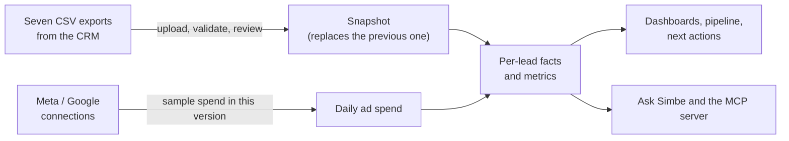

# About Simbe

Simbe is a web app (desktop and mobile) for **surrogacy agencies**. It connects what an agency spends on ads (Meta, Google) to how its recruiting funnel performs, and answers one question:

> **Which ads, process steps and people turn spend into qualified surrogates?**

It is meant to be opened on Monday morning by an agency owner who wants to know where to spend the next hour, and every day by the coordinators who talk to candidates and need to know who to contact next.

This page is the plain-language overview. For how it was built see [`build-report.md`](./build-report.md); for the rules the code follows see [`conventions/`](./conventions/README.md); for the visual design see `../handoff/design/README.md` and [`design/brand.md`](./design/brand.md).

## Who uses it

| Role | What they do | What they see |
|---|---|---|
| **Owner** (agency owner) | Signs up, creates the agency, loads data, connects ad accounts, invites the team | Everything: insights, the pipeline, coordinator performance, data sources, Claude/MCP setup and settings |
| **Coordinator** (recruiter) | Works candidates through the process | Only their own leads and a daily list of next actions. No spend, no settings, no other coordinators' numbers |

Every agency's data is completely separate from every other agency's. Two agencies using the same app can never see each other's leads, spend or conversations.

## The funnel Simbe measures

A candidate (a *lead*) moves through these stages:

**Inquiry → Application → Consult booked → Attended consult → Records → Accepted**

Leads can also be closed (not eligible, withdrew, unresponsive) or paused with a date to come back. Simbe shows, for every stage, how many leads reached it, what share of the previous stage that is, and why people left.

**"Qualified" is each agency's own definition.** An agency picks one milestone in its settings, and every number in the app follows it: *submitted an application*, *attended a consult*, *reached records* or *accepted*. One agency may call a lead qualified once she attended a consult; another only once her records are in. Changing the definition updates every number immediately.

## What you can do in the app

**For owners**

- **This week:** the home screen. Four headline numbers (leads, qualified, qualified rate, cost per qualified) over 30 days, 90 days or 12 months, a short list of *recommended actions* (each tagged Process, Ads or People, with an impact line and an "Ask why" button), the biggest leak in the funnel, and cost per qualified by channel.
- **Funnel:** stage by stage, with the exit reasons, and where applicants stop inside the application form.
- **Channels:** leads, qualified, rate, spend and cost per qualified for Facebook, Instagram, Google, referrals and more; click through for the campaigns inside a channel. It also flags data quality, for example the share of leads with no source, or outside the states the agency works in.
- **Pipeline:** a board (Action needed, In application, Consult, Qualified) or a list, filterable by coordinator. Click any lead to open the **lead panel**.
- **Lead panel:** contact details, a screener progress ring, consult status, and tabs for the process summary (with a short AI-written summary and a suggested next step), the screener answers, the activity timeline and the lead's source.
- **Coordinators:** one card per person with first-reply time, qualified count and overdue items, flagged "needs support" when many are overdue. Differences can come from lead mix as well as effort, and the screen says so.
- **Data sources:** connect Meta and Google, see which seven CRM export files are loaded and when, and **upload a new snapshot**.
- **Connect Claude:** the agency's MCP address, an API key and the tools Claude can use (see below).
- **Settings:** the definition of qualified, the time zone, and the team (invite coordinators).
- **Search:** a command palette (Ctrl or Cmd K) to jump to any lead or screen.

**For coordinators**

- **Next actions:** the daily home, most urgent first, in four queues:
  - *Text back now:* new leads nobody has messaged.
  - *Nudge applications:* quiet for 24 hours or more in the middle of the application.
  - *Rebook consults:* no-shows with no new booking.
  - *Paused, due back:* the return date has passed.
  Each card has Text, Call and Done buttons, and a "Today's progress" counter shows how many are done.
- **My leads:** the pipeline, limited to their own leads, with the same lead panel.

**For everyone: Ask Simbe**

An AI assistant available from every screen. Ask in plain language ("Which channel is cheapest per qualified surrogate?") and it answers from the signed-in agency's own data, with an inline chart, a suggested action that jumps to the right screen, source chips, and follow-up questions. Owners and coordinators get answers within their own access.

## How data gets in

- **CRM exports.** An agency uploads seven CSV files: leads, stage history, contact log, screener answers, web sessions, appointments and applications. The files carry no agency identifier, so Simbe tags every row itself.
- **Snapshots, not syncs.** Each upload is a *full snapshot*. Simbe validates it and shows a review (row counts, what changed, duplicates) before replacing the agency's data **in one step**. A failed load rolls back to the previous snapshot, and loading the same export twice never double counts.
- **Ad spend is sample data in this version.** The exports contain no spend. Connecting Meta or Google records the connection and generates a deterministic *placeholder* cost per lead for the paid channels, and the screens label it "sample spend". Real ad-account syncs are not built yet.
- **Time zones.** Dates and "this week" follow the agency's own time zone (Pacific, Mountain, Central or Eastern), chosen at sign-up and changeable in Settings.

## Privacy and safety

- **Isolation:** enforced both in code and in the database. A request for another agency's record behaves as if it does not exist.
- **Screener answers are health information.** They are encrypted at rest, never written to logs, never sent to the AI provider word for word, and visible only to the coordinator assigned to the lead.
- **Single-flight actions:** clicking a button twice cannot run an action twice.
- **Secrets and real data:** the real sample exports, environment files and keys are never committed; automated guards fail the build if they are.

## Claude and MCP

Besides the in-app assistant, an owner can connect the agency's data to **Claude** (or any MCP client) with a server address and a key. Claude can then use five read-only tools: funnel, channel performance, drop-off reasons, next actions and spend forecast. A key is bound to one agency, shown once, and replaced when rotated; the old one stops working at once.

What the agent can and cannot do, with its tools and limits: [`agent.md`](./agent.md). How to connect Claude: the root [`README.md`](../README.md#connect-claude-and-other-mcp-clients).

## What it is not (yet)

- No real Meta or Google spend sync (placeholder spend only).
- No email verification, password reset, single sign-on or multi-factor sign-in.
- No billing, no deleting an agency, one owner per agency.
- English only.

## Glossary

| Term | Meaning |
|---|---|
| **Lead** | A candidate who inquired. Imported leads keep the export's `lead_id`. |
| **Snapshot** | One full load of an agency's seven CSV exports, with an "as of" time. |
| **Qualified** | The milestone the agency chose in Settings. Not a column on the lead. |
| **Channel** | A normalised source (messy spellings like fb, Facebook and facebook become one). |
| **Queue** | One of the four coordinator to-do lists on Next actions. |
| **Lane** | A unit of build work (one worktree, one branch, one PR). See the build report. |
| **MCP** | Model Context Protocol: how Claude connects to the agency's data. |

## Where to go next

| I want to... | Read |
|---|---|
| Run it locally | the root [`README.md`](../README.md) |
| See how it was built and why Postgres | [`build-report.md`](./build-report.md) |
| Understand the data model and tenancy | [`conventions/database.md`](./conventions/database.md), [`conventions/multi-tenancy.md`](./conventions/multi-tenancy.md) |
| Handle the sensitive data correctly | [`conventions/sensitive-data.md`](./conventions/sensitive-data.md) |
| Deploy and operate it | [`operations/`](./operations/README.md) |
