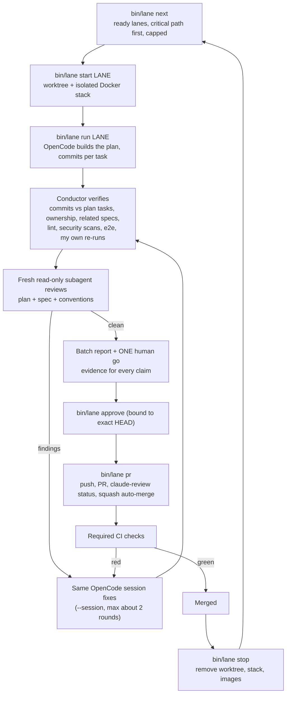
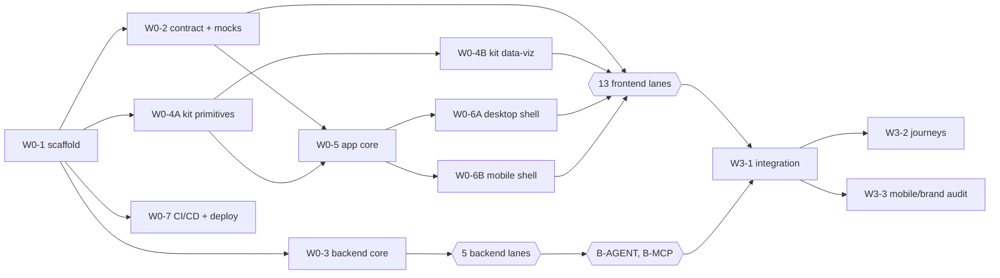

# How Simbe was built: orchestration, lanes, architecture and database

*Written 2026-10-18, after all 32 lanes merged. Everything here is taken from the repository, the PR history and the recorded lane state; where something was not recorded, this report says so instead of guessing.*

## 1. Summary

Simbe is a web app (desktop and mobile) for surrogacy agencies: owners see how their leads move through a funnel, which channels work, and what their coordinators should do next; an AI agent ("Ask Simbe") and an MCP server answer questions over the same data. Two agencies must never see each other's data.

The app was built by **one Claude Code session acting as conductor**, driving **many OpenCode agents in parallel**, one per *lane*. A lane is a git worktree, a branch and exactly one pull request. The work was split into **32 lanes** in four waves. Every finished lane was verified by the conductor, reviewed by a **fresh, read-only Claude subagent**, fixed in the same OpenCode session, re-verified, and published only after **one human "go" per batch**. Merges happen automatically (squash) once the required CI checks pass.

| | |
|---|---|
| Lanes | 32 (9 foundation, 13 frontend, 5 backend, 2 agent/MCP, 3 integration) |
| Pull requests merged | 44 before this one (the 32 lanes plus specs, plans, tooling and fixes; nine automated dependency-bump PRs were closed unmerged) |
| First spec PR to last lane merged | 2026-10-14 23:31 UTC to 2026-10-18 11:19 UTC (about 3.5 days) |
| Builder model | `opencode-go/deepseek-v4.1-flash` for 23 lanes, `opencode-go/kimi-k3` for 2, not recorded for 7 (see section 4) |
| Conductor and reviewers | Claude (Claude Sonnet 5.5 in the final session) |
| Tests at the end | about 610 RSpec examples, about 820 Vitest tests, 94 Playwright mock-mode tests, an axe-based audit (35 screens x 9 widths) |
| Production | Fly.io app `simbe` in `ord`, single machine, unmanaged Postgres 16 (see section 11) |

## 2. The product and the stack

- **Roles:** `owner` and `coordinator`. A coordinator sees only their own leads (`users.coordinator_name` matches `leads.coordinator_name`).
- **Data:** an agency loads seven CSV exports (leads, stage history, contact log, screener answers, web sessions, appointments, applications) as a **full snapshot**. Loading a newer snapshot replaces the old one in one transaction and never double counts. Two real sample agencies exist locally: Harbor (3,530 leads) and Lakeside (29,740 leads, about 625,000 rows across its seven files). The exports are git-ignored and never committed.
- **Stack:** one Rails 8 monolith at the repo root (full Rails, not API-only) with PostgreSQL 16 and Solid Queue running inside Puma; React 19 + TypeScript (strict) + Tailwind 3.4, embedded with `vite_rails` (no Inertia, no separate frontend deployment); a JSON API under `/api/v1` described by an OpenAPI contract; Anthropic Claude for the agent.
- **Qualified is configuration, not a column:** `agencies.qualified_milestone` (`application_submitted`, `consult_attended`, `records` or `accepted`) decides what counts as qualified.
- **Non-negotiables** (from `CLAUDE.md`): agency isolation; screener answers are health data (encrypted, never logged, never sent to the AI provider verbatim, visible only to the assigned coordinator); never commit exports or `.env`; one commit per plan task plus `make verify`; verification through Docker/make; UI is not done until seen at desktop and mobile widths; mutations are single-flight.

## 3. How the work was orchestrated

### 3.1 Roles

| Role | Who | Responsibility |
|---|---|---|
| **Conductor** | One Claude Code session (me) | Scheduling, dispatch, verification, review coordination, batch reports, publishing, cleanup. Never trusts an agent's own summary. |
| **Builders** | OpenCode agents (headless `opencode run`, one per lane, `lane` agent profile) | Implement a lane's plan task by task, run the plan's verifications, commit after each task. Cannot push, open PRs or touch the main checkout (locked permissions). |
| **Reviewers** | Fresh read-only Claude subagents, one per finished lane | Independent code review against the lane plan, spec and conventions. They do not run the Rails suite (the conductor does). |
| **Human** | The repository owner | One "go" per batch of reviewed lanes, plus decisions the agents must not take (rulings on plan defects, spending, secrets, security controls). |

### 3.2 The lane model

- **Plans first.** Before any code, specs (decisions) and plans (exact tasks, file maps, runnable acceptance commands) were written for all 32 lanes (`docs/superpowers/specs/`, `docs/superpowers/plans/`). Each plan has an **`Owns`** line listing the only files that lane may touch.
- **One lane = one worktree = one branch (`lane/<ID>-<slug>`) = one PR.** Each lane worktree has its own Docker stack (own database and ports), so lanes cannot disturb each other. Frontend-only lanes run on the host with Node because the frontend develops against a mock API.
- **Ownership is enforced by tooling**, not trust: `bin/lane check` and `docs/superpowers/parallel/check-ownership.sh` fail when a lane touches files outside its `Owns` list. Overlaps are only allowed when a later lane lists the earlier one under "Depends on (merged)". Where a plan needed files outside its `Owns` (for example Wave 3 fixes), the conductor extended the plan's `Owns` line explicitly and said so in the go request.
- **Shared changes go through a Contract Change Request**, never silently.

### 3.3 The conductor loop

Key mechanics, all in `bin/lane` (stdlib Python, tested by RSpec specs in `spec/tooling/`):

- **`next`** computes which lanes may start: every direct prerequisite merged, nothing already running for that lane, ordered by how many lanes it transitively unblocks. Caps (`max_running`, `max_stacks`, `max_waiting`) keep the machine and the review budget sane; they are set to 6 in the final configuration (Docker Desktop has 12 GB).
- **`run`** launches OpenCode headless with a prompt that embeds the lane rules, records the OpenCode **session id** in the state file (`.superpowers/orchestrator/state.json`), and applies guards: a main-checkout tripwire, a timeout, and an exit code when a run ends with **uncommitted work**. A run that exits 0 is not a finished lane: the conductor counts commits against the plan's tasks and resumes the session until they match.
- **`watchdog`** flags a run whose log has been quiet for too long (30 minutes by default). Known limitation: it treats a quiet log as a stall even while the agent is waiting on a long foreground command (for example a full test run); the conductor checks the process list and the database before acting on it. Making it aware of running child commands is still to do.
- **`approve`** records the human approval bound to the exact commit; **`pr`** pushes (with `--force-with-lease` against the previous head when a branch was rewritten), opens or updates the PR, posts the `claude-review` commit status for the approved head and enables squash auto-merge. A new head has no status, so it cannot merge without a new approval.
- **State phases:** `queued, running, verifying, fixing, ready, approved, ci, merged, blocked`.

### 3.4 Verification (the conductor's, never the agent's claim)

For every lane the conductor re-ran, on the rebased branch: ownership check, `make verify-changed` (lint, boundaries and only the specs related to the change), Brakeman, the frontend type/lint/unit/knip checks on the repo's Node version, the Playwright suites, and where relevant the real-data oracle or the audit. The expected outputs came from commands, not from the agent's summary, and the go request listed **what was reproduced by the conductor and what was only taken from the agent**.

Two supporting tools were built mid-project because full-suite runs per task were too slow:

- `bin/affected-specs` and `make verify-changed` run only the specs related to what a branch changed (plus guard specs for boundaries, isolation and routing); the full `make verify` runs once at the end of a lane.
- The real-data golden oracles became opt-in (`REAL_DATA=1` or a `spec/real_data` path), because each example reloads hundreds of thousands of rows.

### 3.5 Independent review and fix rounds

A fresh subagent (no conductor context) reviewed each finished lane read-only: it reads the plan, spec, conventions and brand rules, and reports only verified findings with a file, a concrete failure scenario and a severity. Findings go back to the **same OpenCode session** so the builder keeps its context; at most about two rounds, and the conductor re-verifies after each. The conductor also *confirms findings in the code* before sending them, and rules on plan defects.

Examples of what independent review caught (not exhaustive):

- **B-MCP:** the rate limit was keyed on whatever token was sent (bypassable with random tokens), key lookup scanned every key, malformed JSON-RPC parameters returned 500, key rotation was not atomic, and a key acted as an arbitrary owner instead of its creator.
- **B-INGEST:** races between concurrent commits and cancels could mark an upload failed while it was still importing; storage accepted unknown file names.
- **W3-1:** role-matrix assertions that could pass vacuously; a cross-agency check covering only six ids.
- **W3-3:** an audit harness that passed on timing luck (a lost Ctrl+K keypress before the shell mounted); the conductor's own re-run exposed it, the agent's run had not.
- **Composite foreign keys without indexes** across the schema (fixed in PR #40), a stray `alert(` string caught by the boundaries scan, and out-of-lane edits flagged by the ownership check.

### 3.6 Human gates

The human decided at gates the agents cannot cross: one **"go" per batch** (batches 1 to 12 over the project), rulings that change a plan or touch security controls, spending and secrets (database plan, production keys), and the claude-review status for non-lane PRs. The conductor never self-approved a non-lane PR and never relaxed branch protection (`main` requires reviews, 13 checks and linear history, including for admins).

### 3.7 Safety rails that mattered

- OpenCode's lane agent has an allowlisted shell and **no push, PR or main-checkout access**; the conductor publishes.
- Secrets and real data: `bin/guard-no-health-data` blocks exports, env files, keys and stray CSVs; gitleaks scans every commit of every PR (and caught a false positive in PR #52, fixed by rewording the commit instead of adding a scanner exception).
- Lane tooling never touches the main checkout while runs are active.

### 3.8 What did not go smoothly (lessons)

| Problem | What was done |
|---|---|
| `opencode run` hangs when stdin is an open non-TTY | Always run with stdin from `/dev/null` (`bin/lane run` does it) |
| OpenCode usage windows (a 5-hour window and a weekly cap) can return 429 | Resume with `--session` after the window; do a lane inline if the weekly cap is hit |
| The lane agent's allowlist denied commands its own prompt required; runs ended mid-plan with exit 0 | Prompts and allowlist aligned; the conductor counts commits against the plan and resumes |
| Runs that exited with work uncommitted | `run` now fails the lane (exit 6) and the conductor resumes it |
| A long quiet log looked like a stall (a 55-minute real-data run) | The conductor checks the process list and the database before acting; making the watchdog aware of running child commands is still to do |
| A machine sleep interrupted a run | Same-session resume with the unfinished items |
| Concurrent RSpec runs deadlocked on a shared database | One RSpec run per worktree database at a time, always `RAILS_ENV=test` |
| Real-data oracles made every lane run for an hour | Opt-in oracles, `verify-changed` |
| The first production deploy would have failed (`db:prepare` seeds a fresh database and `db/seeds.rb` aborts in production) | First deploy used a one-time `db:schema:load` release command; a permanent seeds fix is a follow-up |
| The conductor's own checks sometimes fired early or late (background waiters with inverted conditions, and a gitleaks scan that was not part of the pre-go checks) | Waiters corrected; a gitleaks scan before each go is now done by hand and is still to be added to the checklist document |

## 4. Models used

| Role | Model | Notes |
|---|---|---|
| Builders (23 lanes) | `opencode-go/deepseek-v4.1-flash` | The standing choice for every build run. |
| Builders (2 lanes: W0-3, W0-5) | `opencode-go/kimi-k3` | Used early, before the single-model decision. |
| Builders (7 lanes: W0-1, W0-6A, W0-6B, F-WEEK, F-FUNNEL, F-CHANNELS, F-CONNECT) | **not recorded** | The lane state has no model for them (built before model tracking, or inline). This report does not guess. |
| Conductor | Claude (Claude Sonnet 5.5 in the final session) | Earlier planning sessions' models are not recorded in the repo. |
| Reviewers | Fresh general-purpose Claude subagents | Inherit the conductor's model; read-only. |

The lane state keeps per-tier model defaults (`cheap`, `mid`, `top`); all three were set to `opencode-go/deepseek-v4.1-flash`.

## 5. The lanes

32 lanes in four waves. Merge times are when the PR merged (UTC), not how long a lane took to build: several Wave 0 PRs merged within seconds of being opened, because the work had been done earlier on their branches.

**Waves:** 0 = foundation (scaffold, contract, backend core, UI kit, app core, shells, CI/CD); 1 = features (5 backend, 13 frontend lanes, runnable in parallel because the frontend develops against a mock API generated from the contract); 2 = the AI agent and MCP server, which need the Wave 1 backend; 3 = integration, journeys and the mobile/accessibility/brand audit.

| Lane | Wave | What it built | Builder model | PR | Merged (UTC) |
|---|---|---|---|---|---|
| W0-1 | 0 | Rails monolith scaffold: packs, `vite_rails`, mock host, per-worktree Docker stacks | `not recorded` | [#8](https://github.com/Sophia-Sergio/simbe/pull/8) | 2026-10-15 06:04 |
| W0-2 | 0 | OpenAPI contract tooling, generated typed hooks, MSW mock API | `deepseek-v4.1-flash` | [#11](https://github.com/Sophia-Sergio/simbe/pull/11) | 2026-10-15 10:34 |
| W0-3 | 0 | Backend core: auth, schema, tenancy (`AgencyScoped`), the Alpha test scenario | `kimi-k3` | [#26](https://github.com/Sophia-Sergio/simbe/pull/26) | 2026-10-17 15:02 |
| W0-4A | 0 | UI kit primitives (buttons, fields, modal, sheet, toast, tables) | `deepseek-v4.1-flash` | [#9](https://github.com/Sophia-Sergio/simbe/pull/9) | 2026-10-15 08:08 |
| W0-4B | 0 | UI kit data-viz (bars, rings, donut, segment bar) and shared pieces | `deepseek-v4.1-flash` | [#12](https://github.com/Sophia-Sergio/simbe/pull/12) | 2026-10-15 10:35 |
| W0-5 | 0 | App core: router, auth provider, feature registry, query client | `kimi-k3` | [#13](https://github.com/Sophia-Sergio/simbe/pull/13) | 2026-10-15 11:41 |
| W0-6A | 0 | Desktop shell (224 px sidebar, 56 px top bar) | `not recorded` | [#14](https://github.com/Sophia-Sergio/simbe/pull/14) | 2026-10-15 12:09 |
| W0-6B | 0 | Mobile shell (top bar, bottom tab bar, More sheet) | `not recorded` | [#15](https://github.com/Sophia-Sergio/simbe/pull/15) | 2026-10-15 12:09 |
| W0-7 | 0 | CI/CD pipeline, production image, Fly deploy job, agent tooling | `deepseek-v4.1-flash` | [#16](https://github.com/Sophia-Sergio/simbe/pull/16) | 2026-10-15 13:33 |
| B-INGEST | 1 | Snapshot upload API, validator, importer (streamed `COPY`, atomic replace, advisory lock) | `deepseek-v4.1-flash` | [#48](https://github.com/Sophia-Sergio/simbe/pull/48) | 2026-10-17 22:38 |
| B-METRICS | 1 | Metrics summary, funnel, channels, deterministic recommendations (SQL) | `deepseek-v4.1-flash` | [#42](https://github.com/Sophia-Sergio/simbe/pull/42) | 2026-10-17 18:53 |
| B-LEADS | 1 | Lead queues, list, board and detail, with screener masking | `deepseek-v4.1-flash` | [#38](https://github.com/Sophia-Sergio/simbe/pull/38) | 2026-10-17 18:50 |
| B-ACTIONS | 1 | Next actions, completions, coordinator stats | `deepseek-v4.1-flash` | [#39](https://github.com/Sophia-Sergio/simbe/pull/39) | 2026-10-17 18:51 |
| B-ACCOUNT | 1 | Sign-up, agency settings, team, invitations | `deepseek-v4.1-flash` | [#33](https://github.com/Sophia-Sergio/simbe/pull/33) | 2026-10-17 17:37 |
| F-WEEK | 1 | This week dashboard | `not recorded` | [#27](https://github.com/Sophia-Sergio/simbe/pull/27) | 2026-10-17 14:11 |
| F-FUNNEL | 1 | Funnel screen | `not recorded` | [#28](https://github.com/Sophia-Sergio/simbe/pull/28) | 2026-10-17 14:11 |
| F-CHANNELS | 1 | Channels list and channel detail | `not recorded` | [#29](https://github.com/Sophia-Sergio/simbe/pull/29) | 2026-10-17 14:12 |
| F-PIPELINE | 1 | Pipeline board and list | `deepseek-v4.1-flash` | [#31](https://github.com/Sophia-Sergio/simbe/pull/31) | 2026-10-17 15:54 |
| F-LEADPANEL | 1 | Lead slide-over (summary, screener, activity, source) | `deepseek-v4.1-flash` | [#30](https://github.com/Sophia-Sergio/simbe/pull/30) | 2026-10-17 16:03 |
| F-NEXTACTIONS | 1 | Coordinator home (next actions) | `deepseek-v4.1-flash` | [#32](https://github.com/Sophia-Sergio/simbe/pull/32) | 2026-10-17 15:54 |
| F-COORDINATORS | 1 | Coordinators grid and detail | `deepseek-v4.1-flash` | [#36](https://github.com/Sophia-Sergio/simbe/pull/36) | 2026-10-17 18:50 |
| F-SEARCH | 1 | Command palette (Ctrl or Cmd K) | `deepseek-v4.1-flash` | [#49](https://github.com/Sophia-Sergio/simbe/pull/49) | 2026-10-17 22:41 |
| F-SIGNUP | 1 | Sign-up wizard, including the seven-file upload step | `deepseek-v4.1-flash` | [#45](https://github.com/Sophia-Sergio/simbe/pull/45) | 2026-10-17 22:37 |
| F-DATA | 1 | Data sources and upload | `deepseek-v4.1-flash` | [#44](https://github.com/Sophia-Sergio/simbe/pull/44) | 2026-10-17 22:37 |
| F-SETTINGS | 1 | Settings and accept-invite | `deepseek-v4.1-flash` | [#46](https://github.com/Sophia-Sergio/simbe/pull/46) | 2026-10-17 22:38 |
| F-AGENT | 1 | Ask Simbe panel | `deepseek-v4.1-flash` | [#37](https://github.com/Sophia-Sergio/simbe/pull/37) | 2026-10-17 19:12 |
| F-CONNECT | 1 | Connect Claude (MCP) page | `not recorded` | [#34](https://github.com/Sophia-Sergio/simbe/pull/34) | 2026-10-17 17:37 |
| B-AGENT | 2 | Anthropic client, tools, turn loop, usage ledger | `deepseek-v4.1-flash` | [#47](https://github.com/Sophia-Sergio/simbe/pull/47) | 2026-10-17 22:37 |
| B-MCP | 2 | MCP server (JSON-RPC at `/mcp/:slug`) and key management | `deepseek-v4.1-flash` | [#50](https://github.com/Sophia-Sergio/simbe/pull/50) | 2026-10-17 23:21 |
| W3-1 | 3 | Integration: real-API default, contract parity, role and tenancy matrix, knip guard | `deepseek-v4.1-flash` | [#51](https://github.com/Sophia-Sergio/simbe/pull/51) | 2026-10-18 01:29 |
| W3-2 | 3 | Six end-to-end user journeys, desktop and mobile | `deepseek-v4.1-flash` | [#52](https://github.com/Sophia-Sergio/simbe/pull/52) | 2026-10-18 03:50 |
| W3-3 | 3 | Mobile, accessibility and brand audit (axe, 44 px targets, 9 widths) | `deepseek-v4.1-flash` | [#53](https://github.com/Sophia-Sergio/simbe/pull/53) | 2026-10-18 11:19 |

## 6. Timeline

| Date (UTC) | What happened |
|---|---|
| 2026-10-14 to 10-15 | Specs, plans and guidelines (PR #1), the parallel-build setup, contract, 32 lane plans and CI/CD plan (#2 to #5), opened on the 14th and merged in the first hour of the 15th UTC. |
| 2026-10-15 | Rails monolith restructure (#4); the lane conductor spec and review gate (#6, #7); Wave 0 foundation lanes merge (#8 to #16). |
| 2026-10-17 | Backend core (#26); the Wave 1 lanes in batches (#27 to #50): first the early frontend lanes, then backend and the rest, plus tooling fixes (#35, #41, #43) and the composite-index fix (#40). B-AGENT and B-MCP (Wave 2) merge. |
| 2026-10-18 | W3-1 (01:29), W3-2 (03:50) and W3-3 (11:19) merge; first Fly deploy the same day. |

## 7. The database

### 7.1 Choice and why

**PostgreSQL 16**, one database, used for everything: tenant data, sessions, background jobs (Solid Queue tables live in the same database, so there is no Redis), and the AI usage ledger. The stack (Rails with Postgres 16) was a given in the brief; this is why the design leans on it:

- **Isolation enforced by the database, not only by code.** Every tenant row has `agency_id uuid NOT NULL`, and child tables reference their parent with a **composite foreign key `(agency_id, <parent>_id)` to `(agency_id, id)`**, so a row can never point at another agency's lead, user or conversation even if application code is wrong. Each composite foreign key has a matching composite index (checked by a spec that fails when one is missing). On top of that: `Current.agency` comes only from the session; every tenant model includes `AgencyScoped`; other agencies' ids return 404; an isolation spec drives every route as another agency.
- **Snapshot loads need transactions and bulk speed.** A reload deletes the agency's rows in foreign-key-safe order and bulk-inserts the new snapshot in **one transaction** (all or nothing, idempotent), using streamed `COPY`, then runs `ANALYZE` so the next replace gets index plans. In verification, Lakeside's roughly 625,000 rows took 16 s to validate, 42 s to import and **46 s** for a replace, against a 120 s budget. A Postgres advisory lock keeps two loads for one agency from running at once.
- **Agency-local time.** Timestamps are `timestamptz` in UTC; metrics convert with `AT TIME ZONE agencies.timezone` at query time, so the same data answers correctly for a Pacific and a Central agency.
- **Heavy aggregates are SQL.** Funnels, channel performance and queues are CTE-based queries over a derived `lead_facts` table, not Ruby loops over 30,000 leads; raw SQL always receives `agency_id` as a bind parameter.
- **`jsonb` where the shape varies:** upload progress and validation reports, snapshot row counts and warnings, agent messages.
- **Sensitive data:** screener answers are encrypted at rest with Active Record Encryption (three keys held outside the repo), are never logged, and are exposed only to the assigned coordinator.
- **Credentials as digests:** session tokens, invitation tokens and MCP keys are stored only as digests (MCP keys: SHA-256 with a visible prefix; the raw key is shown once).
- **UUID primary keys** on Simbe tables; imported leads keep the export's `lead_id` as `external_id` beside a surrogate `id`.
- **Qualified is configuration:** `agencies.qualified_milestone`, never a column on leads.

### 7.2 Entity-relationship diagram

All edges below with an `agency_id` are composite foreign keys `(agency_id, id)`; every tenant table also references `agencies` with `ON DELETE CASCADE`. Solid Queue's own tables are omitted. Only key columns are shown; `db/schema.rb` is the source of truth.

```mermaid
erDiagram
  agencies ||--o{ users : has
  agencies ||--o{ leads : owns
  agencies ||--o{ snapshots : loads
  agencies ||--o{ snapshot_uploads : receives
  agencies ||--o{ invitations : issues
  agencies ||--o{ mcp_keys : issues
  agencies ||--o{ agent_conversations : hosts
  agencies ||--o{ ai_usage_events : meters
  agencies ||--o{ action_completions : tracks
  users ||--o{ auth_sessions : signs_in
  users ||--o{ invitations : invites
  users ||--o{ mcp_keys : creates
  users ||--o{ snapshot_uploads : uploads
  users ||--o{ snapshots : loads
  users ||--o{ agent_conversations : starts
  users ||--o{ action_completions : completes
  snapshot_uploads ||--o| snapshots : produces
  leads ||--o{ stage_events : moves
  leads ||--o{ contacts : contacted
  leads ||--o{ screener_answers : answers
  leads ||--o{ web_sessions : visits
  leads ||--o{ appointments : books
  leads ||--o{ applications : submits
  leads ||--|| lead_facts : derives
  agent_conversations ||--o{ agent_messages : contains
  agent_conversations ||--o{ ai_usage_events : costs

  agencies {
    uuid id PK
    string name
    string slug UK
    string timezone
    string qualified_milestone
  }
  users {
    uuid id PK
    uuid agency_id FK
    string email
    string role
    string coordinator_name
  }
  auth_sessions {
    uuid id PK
    uuid user_id FK
    string token_digest
    timestamptz expires_at
  }
  invitations {
    uuid id PK
    uuid agency_id FK
    uuid invited_by FK
    string email
    string role
    string token_digest
    timestamptz accepted_at
  }
  mcp_keys {
    uuid id PK
    uuid agency_id FK
    uuid created_by FK
    string key_digest
    string prefix
    timestamptz revoked_at
  }
  snapshot_uploads {
    uuid id PK
    uuid agency_id FK
    uuid user_id FK
    uuid snapshot_id FK
    string status
    jsonb progress
    jsonb report
  }
  snapshots {
    uuid id PK
    uuid agency_id FK
    uuid upload_id FK
    uuid loaded_by FK
    timestamptz as_of
    jsonb row_counts
  }
  leads {
    uuid id PK
    uuid agency_id FK
    uuid external_id
    string channel
    string campaign
    string coordinator_name
    string current_stage
    string outcome
    timestamptz lead_created_at
  }
  stage_events {
    uuid id PK
    uuid agency_id FK
    uuid lead_id FK
    string stage
    timestamptz entered_at
  }
  contacts {
    uuid id PK
    uuid agency_id FK
    uuid lead_id FK
    string direction
    string channel
    timestamptz contacted_at
  }
  screener_answers {
    uuid id PK
    uuid agency_id FK
    uuid lead_id FK
    string question
    text answer "encrypted"
    string meets_requirement
  }
  web_sessions {
    uuid id PK
    uuid agency_id FK
    uuid lead_id FK
    string landing_url
    string device
  }
  appointments {
    uuid id PK
    uuid agency_id FK
    uuid lead_id FK
    string status
    timestamptz scheduled_for
  }
  applications {
    uuid id PK
    uuid agency_id FK
    uuid lead_id FK
    timestamptz submitted_at
    integer percent_complete
  }
  lead_facts {
    uuid id PK
    uuid agency_id FK
    uuid lead_id FK
    string furthest_stage
    integer first_response_minutes
    timestamptz last_contact_at
  }
  action_completions {
    uuid id PK
    uuid agency_id FK
    uuid user_id FK
    uuid lead_external_id
    string queue
    timestamptz snapshot_as_of
  }
  agent_conversations {
    uuid id PK
    uuid agency_id FK
    uuid user_id FK
    string title
  }
  agent_messages {
    uuid id PK
    uuid conversation_id FK
    string role
    jsonb body
  }
  ai_usage_events {
    uuid id PK
    uuid agency_id FK
    uuid conversation_id FK
    string model
    integer input_tokens
    integer output_tokens
    integer cost_cents
  }
```

### 7.3 Data lifecycle

1. An owner uploads the seven CSVs (sign-up wizard step 3, or Data sources later).
2. `SnapshotUpload` is created (`validating`); a job validates the files and writes a report of errors and warnings; the owner reviews it.
3. On commit, one job takes the agency's advisory lock, deletes the old rows and `COPY`s the new ones in one transaction, derives `lead_facts`, writes a `Snapshot` (`as_of`, row counts, warnings), runs `ANALYZE`, and marks the upload `committed`. Cancels and concurrent commits are compare-and-set on the upload status, so a cancel always wins.
4. A golden-number oracle (`bin/golden-numbers`, `spec/real_data/golden.json`, computed straight from the CSVs, independent of the app) checks the app's numbers against the real exports.

## 8. Backend

- **Rails 8.1 monolith, backend organised in packs** (`app/packs/<pack>/app/{models,controllers,services,serializers,jobs,mailers}`), each pack owned by one lane. Packs extend the core through `config/routes`, `config/routes_root` and `config/rack_attack` files that the core loads.

| Pack | Contents |
|---|---|
| `identity` | Agency, User, AuthSession, Invitation; sessions, sign-up, team, invitations |
| `ingest` | Snapshot, SnapshotUpload; Reader, Validator, Importer (`COPY`), Progress, Storage, jobs |
| `leads` | Lead and its child tables; queues, list, board, detail, masking, next actions, coordinator stats |
| `metrics` | Summary, funnel, channels, recommendations (SQL) |
| `agent` | Conversations, messages, usage events; Anthropic client, tools, turn loop |
| `mcp` | MCP keys; JSON-RPC server |

- **API:** JSON under `/api/v1` with an error envelope; **36 operations** described in an OpenAPI contract (`contracts/`). Request specs validate responses against it (`openapi_first`), and a coverage task fails when an operation is not exercised. Contract changes need a Contract Change Request.
- **Auth:** email and password (`has_secure_password`), server-side `auth_sessions`, an opaque `HttpOnly` cookie, 14-day expiry; non-GET requests must carry `X-Requested-With: simbe` (CSRF defence). Two roles; coordinators see only their own leads.
- **Cross-pack discipline:** packs call each other only through public services; `rails boundaries:check` keeps a ratchet list of allowed cross-pack references (entries only ever come out) and also scans the JavaScript.
- **Background work:** Solid Queue in Puma (`SOLID_QUEUE_IN_PUMA=true`), so the Fly machine must not scale to zero.
- **Throttling:** Rack::Attack, with per-pack rules (for example 60 requests a minute per MCP key plus a per-IP backstop).
- **Mail:** invitations through a mailer.

## 9. Frontend

- **React 19 + TypeScript (strict) + Tailwind 3.4**, embedded in Rails with `vite_rails`: Rails serves one shell page and React Router runs in the browser, so there is one origin and one deployable.
- **Typed API layer:** TanStack Query hooks and types are **generated from the OpenAPI contract** (`openapi-typescript`), so frontend and backend cannot drift unnoticed. An **MSW mock API** serves the same contract, which is why 13 frontend lanes could be built in parallel with no backend: `npm run dev:mock` needs no Rails and no Docker.
- **One folder per feature lane:** `app/javascript/features/{week, funnel, channels, pipeline, lead-panel, next-actions, coordinators, search, signup, data, settings, agent, connect}`, auto-registered by each folder's `feature.ts`.
- **Shared UI kit:** about 30 components (Button, Field, Modal, Sheet, Table, Toast, BarChart, Donut, Ring, SegmentBar, KpiCard and others), built to the brand tokens (`docs/design/brand.md`): Inter and Outfit type, pill buttons, 16 to 24 px card radii.
- **Two shells with an 860 px breakpoint:** desktop (224 px sidebar plus 56 px top bar) and mobile (top bar, bottom tab bar, "More" sheet). Owners and coordinators see different navigation.
- **Behaviour rule:** `useAsyncAction` makes every mutation single-flight (a clicked action cannot run twice).
- **Accessibility and mobile audit (W3-3):** an axe-based audit over 35 screens x 9 widths (including 859 and 860) checks overflow, 44 x 44 px tap targets below 860 px, contrast, focus order and reduced motion, in mock and real modes; it is opt-in (`E2E_AUDIT=1`).
- **Testing:** Vitest and Testing Library for units; Playwright with `mock-desktop` (1280x800) and `mock-mobile` (390x844) projects, `real-*` projects against a Rails stack, and six end-to-end user journeys.

## 10. The AI agent and the MCP server

- **Ask Simbe** answers owner and coordinator questions with four read-only tools (`get_funnel`, `get_channel_performance`, `get_dropoff_reasons`, `get_next_actions`) scoped to the signed-in agency and role. Screener answers are never sent to the provider verbatim. Usage (model, tokens, cost) is recorded in `ai_usage_events`. In development an `E2E_STUB_ANTHROPIC` switch replays a canned answer for tests; it is restricted to the development environment.
- **MCP server** (`POST /mcp/:slug`, JSON-RPC): exposes the same four tools to Claude clients. Keys are `simbe_live_` plus random characters, stored as SHA-256 digests with a visible prefix, shown once, revoked on rotation (atomically, under an agency lock), bound to one agency and acting as the owner who created them. Requests are limited by size, content type, a per-key limit and a per-IP backstop; tool errors are results flagged `isError`, never protocol errors.

## 11. Quality gates, CI and deployment

- **`make verify`** is the full local gate and matches CI step for step (`bin/ci-parity` checks that): ownership, no-health-data guard, contract bundle, generated types up to date, RuboCop (omakase), Brakeman, bundler-audit, boundaries, RSpec, contract coverage, ESLint, `tsc`, `npm audit`, Vitest, Playwright, golden JSON validity, knip (dead frontend code, with its export and type rules at error), and `bin/ci-parity`.
- **CI** (`.github/workflows/ci.yml`): required checks on `main` are claude-review, Contract, Brakeman, Bundler audit, npm audit, Unused frontend code, Lint backend, Lint frontend, Backend tests, Frontend tests, E2E (mock API, desktop and mobile), Guards (including gitleaks) and Production image builds. `main` has linear history and squash merges, and the rules apply to admins. `E2E (real API)` runs but is not required yet.
- **Deployment:** `fly.toml` defines one machine (2 shared CPUs, 2 GB) that never scales to zero, an `ord` primary region, a release command, and `/up` as the health check; the CI `deploy` job ships a green `main` once `FLY_API_TOKEN` is set in the GitHub `production` environment.
- **Production status (2026-10-18):** the Fly app `simbe` is live at https://simbe.fly.dev after a first manual deploy; `/up` returns 200, the SPA shell is served, and `/api/v1/me` without a session returns 401. The database is **unmanaged Fly Postgres 16** (one `shared-cpu-1x` machine with 512 MB and a 10 GB volume), chosen over the roughly $38 a month Fly Managed Postgres plan to keep cost low. Fly gives no support, backups or high availability for it, so backups and restore drills are the owner's responsibility (`docs/operations/backups.md` assumes managed Postgres and needs adjusting). Production secrets (`SECRET_KEY_BASE`, the three `AR_ENCRYPTION_*` keys, the database URL) were set on Fly; the Anthropic key is still to be set by the owner. **Losing the `AR_ENCRYPTION_*` keys makes every stored screener answer permanently unreadable.**

## 12. Known gaps and follow-ups

1. **86 of the lane e2e specs fail against the real API** (W3-1 measured 7 passed, 86 failed, 15 skipped): they were written for the mock server (mock password, `?mock=` scenarios). The six W3-2 journeys are the working real-API coverage. This is a batch of per-lane fix PRs no plan has scheduled; `E2E (real API)` stays non-blocking until then.
2. **The full-data oracle was run on a sample in W3-1**, by decision (the full run takes about an hour because each example reloads the exports). The per-lane oracles passed when each lane was verified; W3-2's journey 6 asserted the golden numbers on desktop against the real exports (reported by that lane's agent, not re-run by the conductor); the Lakeside timing was measured separately.
3. **`ExpireUploadsJob` is not scheduled** (`config/recurring.yml` was outside B-INGEST's files).
4. **Contract gaps:** upload create has no documented 422 or 409; cancel does not accept `failed` or `expired` uploads; the MCP key prefix length differs from the contract example; lead detail's `summary.next_step` differs from its fixture.
5. **`db/seeds.rb` aborts in production**, which breaks `db:prepare` on a brand-new database (the first deploy worked around it). The seeds should skip quietly in production.
6. **Unmanaged production Postgres**: set up backups and a restore drill (section 11).
7. **Set the Anthropic key** on Fly and the `FLY_API_TOKEN` GitHub secret so merges deploy automatically.
8. **Licences:** the audit adds `@axe-core/playwright` and `axe-core` (MPL-2.0, dev-only, not shipped).
9. **Pre-go checklist additions:** run a gitleaks scan on the branch, and `rails boundaries:check` for every lane including frontend-only ones.

## 13. Where to look

| What | Where |
|---|---|
| Product and design | `handoff/design/README.md`, `docs/design/brand.md`, `handoff/takehome/docs/data-model.md` |
| Binding conventions | `docs/conventions/` (start at its `README.md`) |
| Specs (decisions) and plans (tasks) | `docs/superpowers/specs/2026-10/`, `docs/superpowers/plans/2026-10/` |
| Lane matrix, ownership, playbook, review gate | `docs/superpowers/parallel/` (`README.md`, `playbook.md`, `review-gate.md`, `dependencies.md`) |
| The conductor design | `docs/superpowers/specs/2026-10/2026-10-14-2330-lane-conductor-design.md` |
| Integration and audit evidence | `docs/superpowers/parallel/integration-log.md`, `docs/superpowers/parallel/audit-report.md` |
| Operations (deploy, secrets, backups, rollback) | `docs/operations/` |
| Conductor tooling | `bin/lane`, `bin/affected-specs`, `bin/verify-changed`, `spec/tooling/` |
| Schema | `db/schema.rb` |
| API contract | `contracts/openapi/` |
