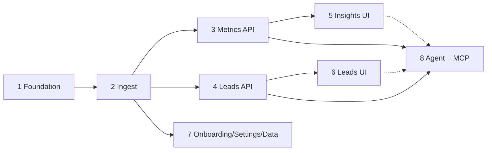

# Superpowers docs: specs, plans and how to implement them

Feature design and implementation docs for the **Claude Code → Cursor / OpenCode** workflow.

| Directory | Written by | Purpose |
|-----------|------------|---------|
| [`specs/`](./specs/) | Claude Code | Design specs: findings, decisions, non-goals, runnable acceptance criteria |
| [`plans/`](./plans/) | Claude Code | Task-by-task implementation plans with tests, code and verification commands |

Project rules live in `../../CLAUDE.md` / `../../AGENTS.md` and `../conventions/`. UI layout comes from `../../handoff/design/`; **colors, type, shapes and logo come from [`../design/brand.md`](../design/brand.md)** (simbefamily.com), which overrides the handoff's brand values.

> **Building with many agents at once?** Use the parallel lane plans: [`parallel/README.md`](./parallel/README.md) (31 lanes in 4 waves, contract-first, mock API for the frontend, per-lane file ownership). The sequence below is the original single-track plan set, kept as the detail reference.

## Build order and dependencies

| # | Feature | Spec | Plan | Depends on |
|---|---------|------|------|-----------|
| 1 | Foundation: monorepo, auth, tenancy, app shell | [spec](./specs/2026-10/2026-10-14-2000-foundation-design.md) | [plan](./plans/2026-10/2026-10-14-2001-foundation.md) | — |
| 2 | Snapshot ingest: validated, atomic, idempotent CSV loads | [spec](./specs/2026-10/2026-10-14-2002-snapshot-ingest-design.md) | [plan](./plans/2026-10/2026-10-14-2003-snapshot-ingest.md) | 1 |
| 3 | Metrics API: KPIs, funnel, channels, recommendations | [spec](./specs/2026-10/2026-10-14-2004-metrics-design.md) | [plan](./plans/2026-10/2026-10-14-2005-metrics.md) | 1, 2 |
| 4 | Leads workflow API: board, lead detail, next actions, coordinators | [spec](./specs/2026-10/2026-10-14-2008-leads-workflow-design.md) | [plan](./plans/2026-10/2026-10-14-2009-leads-workflow-api.md) | 1, 2 |
| 5 | Owner insights UI: This week, Funnel, Channels | [spec](./specs/2026-10/2026-10-14-2006-owner-insights-ui-design.md) | [plan](./plans/2026-10/2026-10-14-2007-owner-insights-ui.md) | 1, 3 |
| 6 | Leads workflow UI: pipeline, lead panel, next actions, coordinators, search | [spec](./specs/2026-10/2026-10-14-2008-leads-workflow-design.md) | [plan](./plans/2026-10/2026-10-14-2010-leads-workflow-ui.md) | 1, 4 |
| 7 | Onboarding, settings, data sources (upload UI) | [spec](./specs/2026-10/2026-10-14-2011-onboarding-settings-data-design.md) | [plan](./plans/2026-10/2026-10-14-2012-onboarding-settings-data.md) | 1, 2 (3 optional) |
| 8 | "Ask Simbe" agent + MCP server + Connect Claude page | [spec](./specs/2026-10/2026-10-14-2013-agent-and-mcp-design.md) | [plan](./plans/2026-10/2026-10-14-2014-agent-and-mcp.md) | 1, 2, 3, 4 (UI also 5, 6) |



**Recommended sequence:** 1 → 2 → (3 ∥ 4 ∥ 7 in parallel worktrees) → (5 after 3, 6 after 4) → 8.
Plans that run in parallel touch different files, but in the original single-track plan set they all appended to shared route/isolation/router files; the lane plans replace that with per-pack route files and per-lane `feature.ts` registration (no shared-file edits) — merge in order and resolve those append-only conflicts by keeping both sides.

## How to implement a plan (Cursor or OpenCode)

1. **Worktree per plan** (never work on `main`):
   ```bash
   git worktree add .worktrees/<feature> -b feat/<feature>
   cd .worktrees/<feature>
   cp /path/to/main/.env .env        # ANTHROPIC_API_KEY etc.
   ```
   Check the plan's **Depends on** line: those plans must already be merged into `main` (rebase onto `main` first).
2. **Open the worktree** in Cursor (or run `opencode` in it) and give it this prompt, with the plan's path:
   > Implement `@docs/superpowers/plans/2026-10/<plan>.md` task by task. Read the plan **and the spec it links**, plus every file in `docs/conventions/` and `docs/design/brand.md`, before writing code. Follow `AGENTS.md`. Run every verification exactly as written. **Commit after each task** (message names the task) once its checks pass. Stop and ask if you are blocked or a verification fails repeatedly — do not replan silently.
   - Cursor loads `.cursor/rules/*.mdc` automatically (conventions + `implement-plans.mdc`). OpenCode reads `AGENTS.md`.
3. **Per task**: write the failing test → see it fail → implement → see it pass → `make verify` (or the task's own checks) → commit. Tick the plan's checkboxes as you go.
4. **Before opening the PR**: run `make verify`; for UI plans run the Playwright screenshot step and compare with `handoff/design/screenshots/` (layout) and `docs/design/brand.md` (colors/shapes/logo); paste the outputs of the spec's **Acceptance criteria** commands into the PR description. Finishing a worktree always opens a pull request.
5. **Review (optional)**: ask Claude Code to review the diff against the plan and spec.

## Environment you need on the host

- Docker Desktop (everything runs in Compose: `make up`, `make setup`, `make verify`).
- A `.env` (git-ignored) with `ANTHROPIC_API_KEY` reused from `../personal/appketing/.env`. Generate the Rails encryption keys with `docker compose exec web bundle exec rails db:encryption:init` (plan 2, Task 1).
- The sample CSV exports in `handoff/takehome/exports/{harbor,lakeside}/` (git-ignored; health data — never commit). Only needed for the "real data" verification steps; all specs use the synthetic **Alpha** scenario.

## Shared test data: the Alpha scenario

Plan 2 defines `ExportBuilder` and `AlphaScenario` (10 leads with fixed timestamps, `as_of` 2026-10-01T12:00Z; derived truths are listed at the top of `alpha_scenario.rb`). Plans 3–8 assert hand-computed numbers on it. Do not change Alpha's data without updating every dependent plan's expectations.

## Writing new specs and plans

Follow `specs/README.md` and `plans/README.md`. Acceptance criteria must be runnable commands, may only assert what the spec's Findings claim, and must not contradict its Decisions or Non-goals.
