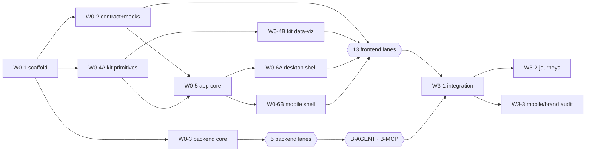

# Parallel build: waves, lanes and how to run many agents at once

The app (desktop + mobile web) is split into **31 lanes** that agents implement concurrently. Design rationale: [`../specs/2026-10/2026-10-14-2100-parallel-build-architecture-design.md`](../specs/2026-10/2026-10-14-2100-parallel-build-architecture-design.md). The earlier feature plans (`2001`–`2014`) remain the **detail library**: lane plans point at their tasks and list the overrides.



## Lane matrix

| Lane | Wave | Depends on | Plan |
|---|---|---|---|
| W0-1 repo scaffold | 0 | — | [2104](../plans/2026-10/2026-10-14-2104-w0-1-repo-scaffold.md) |
| W0-2 contract tooling, hooks, mocks | 0 | W0-1 | [2105](../plans/2026-10/2026-10-14-2105-w0-2-contract-tooling.md) |
| W0-3 backend core (auth, schema, Alpha) | 0 | W0-1 | [2106](../plans/2026-10/2026-10-14-2106-w0-3-backend-core.md) |
| W0-4A UI kit primitives | 0 | W0-1 | [2107](../plans/2026-10/2026-10-14-2107-w0-4a-ui-kit-primitives.md) |
| W0-4B UI kit data-viz + shared pieces | 0 | W0-4A | [2108](../plans/2026-10/2026-10-14-2108-w0-4b-ui-kit-dataviz.md) |
| W0-5 app core | 0 | W0-2, W0-4A | [2109](../plans/2026-10/2026-10-14-2109-w0-5-app-core.md) |
| W0-6A desktop shell | 0 | W0-5 | [2110](../plans/2026-10/2026-10-14-2110-w0-6a-shell-desktop.md) |
| W0-6B mobile shell | 0 | W0-5 | [2111](../plans/2026-10/2026-10-14-2111-w0-6b-shell-mobile.md) |
| B-INGEST importer + upload API | 1 | Wave 0 backend | [2120](../plans/2026-10/2026-10-14-2120-lane-b-ingest.md) |
| B-METRICS metrics + recommendations | 1 | Wave 0 backend | [2121](../plans/2026-10/2026-10-14-2121-lane-b-metrics.md) |
| B-LEADS list, board, detail | 1 | Wave 0 backend | [2122](../plans/2026-10/2026-10-14-2122-lane-b-leads.md) |
| B-ACTIONS next actions, coordinators | 1 | Wave 0 backend | [2123](../plans/2026-10/2026-10-14-2123-lane-b-actions.md) |
| B-ACCOUNT signup, agency, team, invites | 1 | Wave 0 backend | [2124](../plans/2026-10/2026-10-14-2124-lane-b-account.md) |
| F-WEEK This week | 1 | Wave 0 | [2130](../plans/2026-10/2026-10-14-2130-lane-f-week.md) |
| F-FUNNEL Funnel | 1 | Wave 0 | [2131](../plans/2026-10/2026-10-14-2131-lane-f-funnel.md) |
| F-CHANNELS Channels + detail | 1 | Wave 0 | [2132](../plans/2026-10/2026-10-14-2132-lane-f-channels.md) |
| F-PIPELINE board + list | 1 | Wave 0 | [2133](../plans/2026-10/2026-10-14-2133-lane-f-pipeline.md) |
| F-LEADPANEL lead slide-over | 1 | Wave 0 | [2134](../plans/2026-10/2026-10-14-2134-lane-f-leadpanel.md) |
| F-NEXTACTIONS coordinator home | 1 | Wave 0 | [2135](../plans/2026-10/2026-10-14-2135-lane-f-nextactions.md) |
| F-COORDINATORS grid + detail | 1 | Wave 0 | [2136](../plans/2026-10/2026-10-14-2136-lane-f-coordinators.md) |
| F-SEARCH ⌘K palette | 1 | Wave 0 | [2137](../plans/2026-10/2026-10-14-2137-lane-f-search.md) |
| F-SIGNUP wizard | 1 | Wave 0 | [2138](../plans/2026-10/2026-10-14-2138-lane-f-signup.md) |
| F-DATA data sources + upload | 1 | Wave 0 | [2139](../plans/2026-10/2026-10-14-2139-lane-f-data.md) |
| F-SETTINGS settings + accept invite | 1 | Wave 0 | [2140](../plans/2026-10/2026-10-14-2140-lane-f-settings.md) |
| F-AGENT Ask Simbe panel | 1 | Wave 0 | [2141](../plans/2026-10/2026-10-14-2141-lane-f-agent.md) |
| F-CONNECT Connect Claude | 1 | Wave 0 | [2142](../plans/2026-10/2026-10-14-2142-lane-f-connect.md) |
| B-AGENT Ai client, tools, turn loop | 2 | B-METRICS, B-LEADS, B-ACTIONS, B-ACCOUNT | [2150](../plans/2026-10/2026-10-14-2150-lane-b-agent.md) |
| B-MCP MCP server + keys | 2 | B-ACCOUNT (may start with Wave 1) | [2151](../plans/2026-10/2026-10-14-2151-lane-b-mcp.md) |
| W3-1 integration (real API, parity, coverage) | 3 | all above | [2160](../plans/2026-10/2026-10-14-2160-w3-1-integration-real-api.md) |
| W3-2 end-to-end journeys | 3 | W3-1 | [2161](../plans/2026-10/2026-10-14-2161-w3-2-e2e-journeys.md) |
| W3-3 mobile, a11y and brand audit | 3 | W3-1 | [2162](../plans/2026-10/2026-10-14-2162-w3-3-mobile-brand-audit.md) |

## How many agents can run at once

| Phase | Concurrent agents | Notes |
|---|---|---|
| W0-1 | 1 | everyone waits for this (docker, Rails, Vite, extension points) |
| after W0-1 | 4 | W0-2, W0-3, W0-4A (+ W0-4B right after 4A) |
| after W0-5 | 2 more | W0-6A and W0-6B in parallel |
| Wave 1 | **18** | 5 backend + 13 frontend lanes (frontend needs no backend: it runs on the mock API) |
| Wave 2 | 2 | B-AGENT, B-MCP (B-MCP may already start in Wave 1) |
| Wave 3 | 3 | W3-1 first, then W3-2 ∥ W3-3 |

Inside a plan, tasks marked *parallelizable* (W0-2 handlers/hooks, W0-4A/4B components) can be split across more agents.

## Frontend lane rules (binding for every `F-*` plan)

1. **Register, don't edit.** Add `src/features/<lane>/feature.ts` exporting `feature: FeatureModule` (routes, nav, overlays, providers, fab). Never edit the router, nav, shell, providers or another lane's files.
2. **No data layer work.** Hooks come from `@/api/hooks/<domain>` and types from `@/api/types` (Wave 0). If you need a field or endpoint that isn't in `contracts/openapi`, open a **Contract Change Request** (label `ccr`); don't hack around it.
3. **Compose the kit.** Use `src/components/ui/**` and `src/components/shared/**` read-only. If a kit component is missing a prop you need, file an issue against W0-4A/B; for a lane-specific component, build it inside your feature folder.
4. **Mock first.** Develop in mock mode (`VITE_API_MODE=mock`, scenarios `?mock=empty|error|slow|coordinator|new`); tests use `renderWithProviders` + `mockApi` and the contract fixtures.
5. **Both viewports, always.** Every lane's e2e runs the Playwright `desktop` (1280×800) and `mobile` (390×844) projects, saves screenshots, and the PR description includes them next to the matching `design_handoff_simbe/screenshots/` file.
6. **Brand = `docs/design/brand.md`.** Tokens only (no raw hex), Inter/Outfit, pill buttons, plum text, un-tinted logo; icons from `lucide-react`.
7. **Single-flight and dialogs.** Mutations via `useAsyncAction`; no native `alert/confirm/prompt`; no overlay on an overlay (use `ConfirmInline`).
8. **Privacy.** Render raw screener answers only when the API response includes them; never persist passwords/tokens/keys in storage.
9. **Done = checklist in your plan's "Done when" block**, outputs pasted in the PR, `make verify` green, `bin/pr-ownership` clean.

## Backend lane rules (binding for every `B-*` plan)

1. Routes in `backend/config/routes/<lane>.rb`; isolation entries in `backend/spec/support/isolation/<lane>.rb`; Rack::Attack throttles in `backend/config/rack_attack/<lane>.rb`. No migrations (schema shipped in W0-3).
2. Test data through `AlphaScenario.load!` (and `AlphaSpend.load!`), never the CSV importer (except B-INGEST for its own specs).
3. Every request spec runs with OpenAPI conformance on; payloads equal `contracts/examples/**` where the plan says so.
4. Tenancy and privacy rules from `docs/conventions/` are tested in the lane (404 across agencies/coordinators, no raw answers in JSON/logs).

## Nav order table (so lanes never collide)

| Item | Section | Order | Roles | Mobile |
|---|---|---|---|---|
| Next actions (F-NEXTACTIONS) | today | 10 | coordinator | tab 1 |
| My leads (F-PIPELINE) | today | 20 | coordinator | tab 2 |
| This week (F-WEEK) | insights | 10 | owner | tab 1 (Home) |
| Funnel (F-FUNNEL) | insights | 20 | owner | More 1 |
| Channels (F-CHANNELS) | insights | 30 | owner | tab 3 |
| Pipeline (F-PIPELINE) | operations | 40 | owner | tab 2 |
| Coordinators (F-COORDINATORS) | operations | 50 | owner | More 2 |
| Data sources (F-DATA) | agency | 60 | owner | More 3 |
| Connect Claude (F-CONNECT) | agency | 70 | owner | More 4 |
| Settings (F-SETTINGS) | agency | 80 | owner | More 5 |
| Ask (F-AGENT) | today | 90 (`desktop: false`) | owner, coordinator | tab 4 |

Owner tabs therefore render Home / Pipeline / Channels / Ask / More; coordinator tabs Next actions / My leads / Ask.

## Launching agents

For each lane:

```bash
git fetch origin && git worktree add .worktrees/<lane-id> -b lane/<LANE-ID>-<slug> origin/main
cd .worktrees/<lane-id> && cp ../../.env .env
```

Give the agent (Cursor, OpenCode or Claude Code) this prompt, with the plan path filled in:

> Implement `@docs/superpowers/plans/2026-10/<lane plan>.md`. Read the plan, the spec it links, every file in `docs/conventions/`, `docs/design/brand.md` and — for frontend lanes — `docs/superpowers/parallel/README.md#frontend-lane-rules` (backend: the backend lane rules) before writing code. Touch **only** the files in the plan's `Owns` list. Follow the plan's overrides to its "detail reference" tasks exactly. Commit after each task with the message pattern in the plan. Run the plan's "Done when" commands, `make verify`, and `bin/pr-ownership` before opening a PR; paste the outputs and desktop/mobile screenshots in the PR. Stop and ask if blocked or if a needed change is outside your lane — file a Contract Change Request or ask for an ownership change; do not edit shared files.

**Merge protocol:** one PR per lane, rebase on `main` before opening; CI runs `make verify`, the contract job, `ownership-check` and e2e (mock) — merge in any order within a wave; a **`ccr`** PR (contracts + regenerated types, plus the matching mock handler/hook change) jumps the queue and everyone rebases.

**Checks you can run any time:** `bash docs/superpowers/parallel/check-ownership.sh` (no two lanes own the same file) · `make contract` · `make contract-coverage` · `bin/pr-ownership`.

## Where the "other" docs fit

- Product/UI source of truth: `design_handoff_simbe/` (layout, behavior) + `docs/design/brand.md` (look) · data: `harbor-takehome/docs/data-model.md`.
- Feature specs `2000`–`2014` still hold the product decisions; the lane plans carry the execution slicing.
- The first-draft plans (`2001`, `2003`, `2005`, `2007`, `2009`, `2010`, `2012`, `2014`) are **not executed directly** any more — they are referenced task-by-task from the lane plans.
