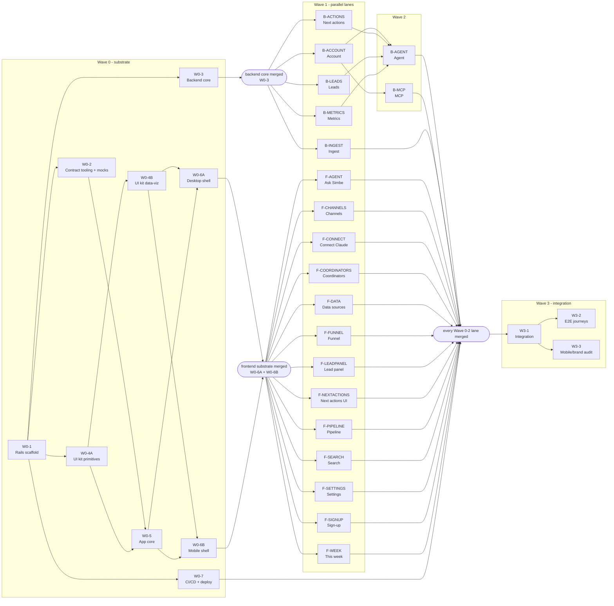

# Plan dependencies

Which plan must be **merged** before which. The diagram and table are **generated from each plan's `Depends on (merged)` line** (`bin/lane graph`), so they can't drift from the plans: edit a plan's dependency line, then run `bin/lane graph --file docs/superpowers/parallel/dependencies.md --write`. Lane list and ownership: [`README.md`](./README.md); how to run them: [`playbook.md`](./playbook.md).

**How to read it:** an arrow `A --> B` means *A must be merged before B can start*. Redundant arrows are removed (if `A → B → C`, there is no `A → C`). Three rounded **gates** collapse arrows that would otherwise be repeated: every frontend lane waits for the same *frontend substrate*, every backend lane for the same *backend core*, and integration waits for everything.

## The diagram and table (generated)

<!-- graph:start -->


| Lane | Wave | Needs merged first (direct) | Unblocks (direct) |
|---|---|---|---|
| W0-1 Rails scaffold | 0 | - | W0-2, W0-3, W0-4A, W0-7 |
| W0-2 Contract tooling + mocks | 0 | W0-1 | W0-5 |
| W0-3 Backend core | 0 | W0-1 | B-ACCOUNT, B-ACTIONS, B-INGEST, B-LEADS, B-METRICS |
| W0-4A UI kit primitives | 0 | W0-1 | W0-4B, W0-5 |
| W0-4B UI kit data-viz | 0 | W0-4A | W0-6A, W0-6B |
| W0-5 App core | 0 | W0-2, W0-4A | W0-6A, W0-6B |
| W0-6A Desktop shell | 0 | W0-4B, W0-5 | 13 lanes (F-AGENT, F-CHANNELS, F-CONNECT, ...) |
| W0-6B Mobile shell | 0 | W0-4B, W0-5 | 13 lanes (F-AGENT, F-CHANNELS, F-CONNECT, ...) |
| W0-7 CI/CD + deploy | 0 | W0-1 | W3-1 |
| B-ACCOUNT Account | 1 | W0-3 | B-AGENT, B-MCP |
| B-ACTIONS Next actions | 1 | W0-3 | B-AGENT |
| B-INGEST Ingest | 1 | W0-3 | W3-1 |
| B-LEADS Leads | 1 | W0-3 | B-AGENT |
| B-METRICS Metrics | 1 | W0-3 | B-AGENT |
| F-AGENT Ask Simbe | 1 | W0-6A, W0-6B (frontend substrate) | W3-1 |
| F-CHANNELS Channels | 1 | W0-6A, W0-6B (frontend substrate) | W3-1 |
| F-CONNECT Connect Claude | 1 | W0-6A, W0-6B (frontend substrate) | W3-1 |
| F-COORDINATORS Coordinators | 1 | W0-6A, W0-6B (frontend substrate) | W3-1 |
| F-DATA Data sources | 1 | W0-6A, W0-6B (frontend substrate) | W3-1 |
| F-FUNNEL Funnel | 1 | W0-6A, W0-6B (frontend substrate) | W3-1 |
| F-LEADPANEL Lead panel | 1 | W0-6A, W0-6B (frontend substrate) | W3-1 |
| F-NEXTACTIONS Next actions UI | 1 | W0-6A, W0-6B (frontend substrate) | W3-1 |
| F-PIPELINE Pipeline | 1 | W0-6A, W0-6B (frontend substrate) | W3-1 |
| F-SEARCH Search | 1 | W0-6A, W0-6B (frontend substrate) | W3-1 |
| F-SETTINGS Settings | 1 | W0-6A, W0-6B (frontend substrate) | W3-1 |
| F-SIGNUP Sign-up | 1 | W0-6A, W0-6B (frontend substrate) | W3-1 |
| F-WEEK This week | 1 | W0-6A, W0-6B (frontend substrate) | W3-1 |
| B-AGENT Agent | 2 | B-ACCOUNT, B-ACTIONS, B-LEADS, B-METRICS | W3-1 |
| B-MCP MCP | 2 | B-ACCOUNT | W3-1 |
| W3-1 Integration | 3 | every Wave 0-2 lane | W3-2, W3-3 |
| W3-2 E2E journeys | 3 | W3-1 |  |
| W3-3 Mobile/brand audit | 3 | W3-1 |  |
<!-- graph:end -->

## Critical paths (what sets the schedule)

| Path | Length | Steps |
|---|---|---|
| Frontend | 7 | W0-1 → W0-4A → W0-4B (or W0-5) → W0-6A / W0-6B → any `F-*` lane → W3-1 → W3-2 / W3-3 |
| Backend | 6 | W0-1 → W0-3 → `B-*` lanes → B-AGENT → W3-1 → W3-2 / W3-3 |
| Deploy | 3 | W0-1 → W0-7 → (first deploy is owner-run; W3-1 verifies the pipeline) |

W0-1 is on every path, so nothing else can start before it merges.

## Earliest start (who can run when)

| Starts when these are merged | Lanes that can start | Agents at once |
|---|---|---|
| nothing | W0-1 | 1 |
| W0-1 | W0-2, W0-3, W0-4A, W0-7 | 4 |
| W0-4A | W0-4B | +1 |
| W0-2 and W0-4A | W0-5 | +1 |
| W0-3 | **B-INGEST, B-METRICS, B-LEADS, B-ACTIONS, B-ACCOUNT** (the five backend lanes) | up to 5, **without waiting for any frontend work** |
| W0-4B and W0-5 | W0-6A, W0-6B | 2 |
| W0-6A and W0-6B | **all 13 frontend lanes** | up to 13, **without waiting for any backend lane** |
| B-ACCOUNT, B-METRICS, B-LEADS, B-ACTIONS | B-AGENT | 1 |
| B-ACCOUNT | B-MCP | 1 |
| every Wave 0-2 lane | W3-1, then W3-2 ∥ W3-3 | 1, then 2 |

The two halves of Wave 1 are independent: backend lanes start as soon as the backend core merges, frontend lanes as soon as the shells merge, and neither side waits for the other (the frontend runs on the mock API).

## What does **not** block a lane (and why)

| Looks like a dependency | Why it isn't | What happens until the other side merges |
|---|---|---|
| Frontend lanes → backend lanes | The OpenAPI contract and the MSW mock API stand in for the backend | Everything runs on mocks; W3-1 switches to the real API |
| Backend lanes → frontend lanes | The backend is specified by the contract and request specs | Nothing |
| Frontend lanes → W0-3 (backend core) and W0-7 (CI/CD) | They only need the frontend substrate | Nothing |
| F-WEEK / F-CHANNELS "Ask why" buttons → F-AGENT | `useAgent()` ships in W0-5 with a no-op default | The buttons call a no-op; tests spy on it |
| F-PIPELINE / F-COORDINATORS / F-NEXTACTIONS / F-SEARCH → F-LEADPANEL | `useLeadPanel()` (URL state) is built in W0-5 | Clicking a lead only sets `?lead=…`; the panel overlay appears when F-LEADPANEL merges |
| F-SIGNUP / F-DATA → each other | The shared pieces (`Dropzone`, `ReviewReport`, `FileChecklist`, `UploadProgress`, …) are kit components from W0-4A/B | Nothing |
| B-MCP → B-AGENT | B-MCP codes against the fixed tool-registry contract with a fake `Agent::Tools` | Its specs use the fake; rerun with `USE_REAL_TOOLS=1` after B-AGENT merges |
| B-ACCOUNT → B-METRICS (sample spend on "connect") | Guarded by `defined?(Spend::SampleGenerator)` | Connecting an ad account doesn't create sample spend yet |

## Real dependencies that are easy to miss

- **B-AGENT needs B-ACCOUNT, B-METRICS, B-LEADS and B-ACTIONS merged**: its tools call their services for real behavior.
- **B-MCP needs B-ACCOUNT** only for the Rack::Attack loader initializer; if you want B-MCP to start in parallel with B-ACCOUNT, have it ship its throttle later (a small, safe reordering).
- **W0-7 (CI/CD) needs only W0-1**, but its pipeline only goes fully green once W0-3 and the kit/shell exist; the deploy itself is an owner-run step.
- **Real-data checks** (`:real_data` specs, `@real` journeys) need the local, git-ignored exports (`handoff/takehome/exports`) and the golden oracle (`spec/real_data/golden.json`, already merged); they never run in CI.
- **Contract Change Requests (`ccr`)** can touch any lane at any time: they are merged first and every open lane rebases.

## Keeping this file correct

```bash
bin/lane graph                                                         # print the diagram + table
bin/lane graph --file docs/superpowers/parallel/dependencies.md --write   # refresh this file
bin/lane graph --file docs/superpowers/parallel/dependencies.md --check   # fails when it is stale (add to CI if you like)
```
Edit the `**Depends on (merged):**` line of a plan (that is the only source) and regenerate; do not edit the generated block by hand.
