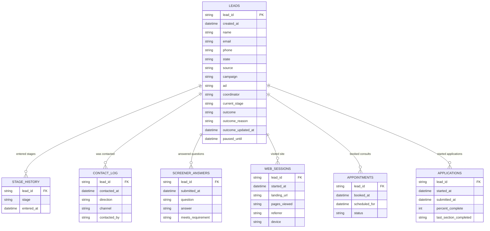

# Data model: how the exports connect

Every file hangs off `lead_id`. There is no other foreign key in the exports — `leads.csv` is the hub, and the other six files are each a log of events tied back to a lead.

## Notes on the join

- **`leads` is 1 row per lead.** Everything else is 0, 1, or many rows per `lead_id` — they're event/history tables, not dimension tables.
- **`stage_history` is the authoritative funnel trail.** `leads.current_stage` is just the latest snapshot; `stage_history` has one row per stage transition (`entered_at`), which is what you need to compute stage-to-stage conversion and time-in-stage. The two should agree but don't have to — a reload could in theory leave `current_stage` stale relative to the log, so treat `stage_history` as the source of truth.
- **`appointments` and `applications` are themselves append-only-ish logs, not 1:1 with a lead.** A lead can rebook (multiple `appointments` rows, distinguished by `status` and `scheduled_for`) or restart an application. Don't assume "latest row" without sorting — there's no row id, only timestamps.
- **`source` / `campaign` / `ad` live only on `leads`**, set once from the first tagged visit, and are blank if the lead was never tagged. `web_sessions` is the richer, multi-row version of that same acquisition story (one row per visit, before the lead existed as a "lead") — join on `lead_id` if you want visit-level detail, but the summary attribution Erin will actually ask about ("which channel") comes off `leads` directly.
- **No agency id in the files** — isolation comes from the folder (`exports/harbor/` vs `exports/lakeside/`), not a column. Whatever you load into Postgres needs to tag every row with an agency id itself (e.g. separate schemas, or a `agency` column enforced at the loader/query layer) since nothing in the CSVs does it for you.
- **Timezone**: all timestamps are UTC. Harbor is Pacific, Lakeside is Central — convert at display time, not at storage time, so the same row works for both "today" definitions if you ever need to re-derive it.
- **"Qualified" is not a column anywhere.** It's `current_stage` (or a `stage_history` row) reaching a threshold that differs per agency — `consult` for Harbor, `records` for Lakeside. That threshold has to be config, not a hardcoded field, if the same schema serves both agencies.
