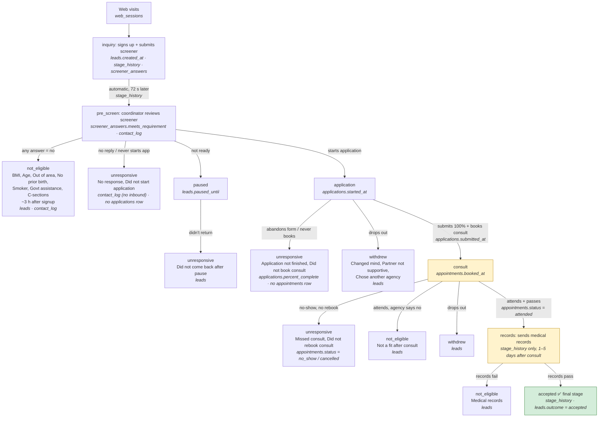

# Export tables: what they contain and what they're for

A summary of the seven CSVs in `exports/harbor/` and `exports/lakeside/`, built from `data-model.md`, `exports/README.md` and a profiling pass over the October 1, 2026 snapshot. It complements [`data-model.md`](./data-model.md), which covers how the files join. This one covers what is inside each file and what to watch for.

All numbers below are counts from the snapshot. The profiling read aggregates only and copied no names, emails, phones or screener answers.

## What's a lead?

**A lead is a woman who has shown interest in becoming a surrogate** (a gestational carrier, who carries a pregnancy for intended parents) by signing up with the agency. Harbor and Lakeside are agencies that *recruit surrogates*. The exports cover only that recruiting side: the intended parents never appear in the data.

A lead's path, per `README.md`:

1. **Arrives** from an ad or channel (Facebook, Instagram, TikTok, Google, referral, word of mouth). Those pre-signup visits are in `web_sessions`.
2. **Fills out a short screener** (age, BMI, prior births, smoking, …), which becomes the `inquiry` → `pre_screen` stages and the `screener_answers` table.
3. **Gets followed up** by a coordinator by text, call and email (`contact_log`).
4. If things go well, she **fills out an application** (`applications`), **books and attends a consult** (`appointments`), **sends medical records**, and is **accepted** into the agency's surrogate program.

Most leads drop out along the way: they turn out to be not eligible, stop responding, withdraw, or pause and may come back later (`leads.outcome`). Each agency defines a **qualified surrogate** as a lead who got far enough. Harbor counts one who has attended a consult; Lakeside counts one who has reached the records stage.

A lead is one *inquiry*, not one person. The same woman can inquire twice and appear as two leads (see "Repeat inquiries" under `leads`).

## The path to a good prospect

The flow below was reconstructed from the data, not taken from a spec. Every lead moves through the stages in order. A lead leaves the funnel at the step where her `outcome` stops being `open`, and `outcome_reason` records why.

Each box names the table (and column) where the step shows up. The stage name is always also a row in `stage_history`, and the exit reasons are always `leads.outcome` / `outcome_reason`.



### Where each step is found, and how we know

Every check below holds for **100% of leads in both agencies**.

| Step | Table · column | Evidence that links it |
|---|---|---|
| Web visits | `web_sessions.started_at` | Every lead has 1–8 visits, all before `leads.created_at` |
| inquiry | `leads.created_at` = `stage_history(inquiry).entered_at` = `screener_answers.submitted_at` | All three timestamps are identical, so signing up *is* submitting the screener |
| pre_screen | `stage_history(pre_screen)` | Exactly 72 s after inquiry for every lead, so it is automatic and not a person's decision |
| Screener verdict | `screener_answers.meets_requirement` | Any `no` → `leads.outcome = not_eligible` at pre_screen. The rejection time (`outcome_updated_at`) equals an outbound `contact_log` row, so a coordinator sends the rejection |
| No response | `contact_log` | All "No response" leads have **zero** inbound contacts |
| Paused | `leads.paused_until` | Set only when `outcome = paused`. "Did not come back after pause" is the exit afterwards |
| application | `applications.started_at` = `stage_history(application).entered_at` | Leads with an `applications` row are exactly the leads at this stage. "Did not start application" leads have no row |
| Application finished | `applications.submitted_at`, `percent_complete = 100` | Every lead who reached consult had submitted. All "Application not finished" leads are unsubmitted |
| consult (booked) | `appointments.booked_at` (first booking) = `stage_history(consult).entered_at` | The stage is entered at **booking**, not attendance. All "Did not book consult" leads submitted but have no appointment |
| Consult attended | `appointments.status = attended` | Every lead who reached records has an attended row. "Missed consult" = a `no_show` row; "Did not rebook" = last booking `cancelled` |
| records | `stage_history(records)` **only** | No records table exists. The stage is entered 1–5 days (median 3) after the attended consult. Whether the records passed shows only as the next stage or as "Medical records" |
| accepted | `stage_history(accepted)` · `leads.outcome = accepted` | `outcome_updated_at` equals the `accepted` entry time |

**What the exports don't contain:** the medical records themselves, consult notes, and the reason behind "Not a fit after consult". Those decisions are recorded only as an outcome code on `leads`.

| Step | What "passing" means | Who drops out here (Harbor / Lakeside) |
|---|---|---|
| 1. Screener (`pre_screen`) | No screener answer is `no` (see below) | 74% / 62% stop here: rejected on screener answers, never reply, or pause |
| 2. Application | Submits the full form (100%) | Abandons the form, never books a consult, or withdraws |
| 3. Consult | **Attends** the booked consult and the agency deems her a fit | No-shows, rejected after the consult, or withdraws |
| 4. Medical records | Records pass review | Rejected on medical records |
| 5. **Accepted** | **Final stage. She is now a surrogate in the agency's program**, ready to be matched with intended parents (matching is not in these exports) | — |

**What counts as a good prospect.** `accepted` is the only real finish line: 300 Harbor leads (8.5%) and 3,941 Lakeside leads (13%). Because acceptance takes weeks or months, each agency also uses an earlier milestone, "qualified", to judge leads sooner:

- **Harbor:** qualified = **attended a consult** (step 3). That is 496 leads (14%), taken from `appointments.status = attended`; no lead attended twice. The 579 leads who *reached* the consult stage only booked one.
- **Lakeside:** qualified = **reached `records`** (step 4). That is 5,172 leads (17%).

See "Seeing each agency's definition of success in the data" below for how to derive each one.

Both definitions rule out a lead who is still sitting at `pre_screen` or `application`. Passing the screener only means *not disqualified*. It does not make her a good prospect.

**Screener result vs. later success (no `no` answers):**

| Worst screener flag | Harbor: reached application / accepted | Lakeside: reached application / accepted |
|---|---|---|
| all `yes` | 53% / 18.3% | 61% / 22.0% |
| at least one `review` | 54% / 15.4% | 60% / 17.7% |

A `review` flag barely changes whether she starts an application, and it lowers her acceptance odds only a little. So `review` means "check later", not "probably bad".

## Seeing each agency's definition of success in the data

**The definitions are not in the exports.** No column, flag or file says "qualified", and the CSVs never say which rule applies to which agency. The rule comes only from the brief (`README.md`). What the data *does* contain is the raw event each definition points to, in a different table for each agency:

| | Harbor: "attended a consult" | Lakeside: "reached records" |
|---|---|---|
| Where to look | `appointments` with `status = attended` | `stage_history` with `stage = records` |
| A lead is qualified when | she has **at least one** attended row | she has a `records` row |
| Date she qualified | `scheduled_for` of her first attended booking (there is no `attended_at` column, so the scheduled time stands in for it) | `entered_at` of the `records` row |
| Note | `stage_history(consult)` is **not** enough: that stage starts at *booking*, and 83 Harbor leads booked without ever attending | `leads.current_stage = records` is **not** enough either: leads that went on to `accepted` passed through records, so use `stage_history` |

Expressed as queries over the loaded tables:

```sql
-- Harbor: qualified = attended a consult
SELECT lead_id, MIN(scheduled_for) AS qualified_at
FROM appointments
WHERE agency_id = 'harbor' AND status = 'attended'
GROUP BY lead_id;

-- Lakeside: qualified = reached records
SELECT lead_id, entered_at AS qualified_at
FROM stage_history
WHERE agency_id = 'lakeside' AND stage = 'records';
```

Because the two queries read different tables, the rule has to be a **per-agency setting** and not a shared column. Hardcoding either rule would give the other agency the wrong number. The section "Implementing the per-agency rule" below shows how. (`agency_id` in these queries is a column the loader adds; the CSVs have none.)

### Both definitions applied to both agencies

Computing both rules for both agencies shows how much the choice of definition moves the headline number. The agency's **own** definition is in bold.

| | Harbor | Lakeside |
|---|---:|---:|
| Attended a consult | **496 (14.1%)**, median 16 days after signup | 6,701 (22.5%), median 15 days |
| Reached records | 400 (11.3%), median 19 days | **5,172 (17.4%)**, median 18 days |
| Accepted (final stage) | 300 (8.5%) | 3,941 (13.3%) |
| Accepted ÷ qualified, own definition | 60.5% | 76.2% |

- **The two rules are nested.** Every lead who reached records had attended a consult (100% in both agencies). Lakeside's rule is therefore Harbor's rule plus one more step: attended, then not rejected and not withdrawn at the consult. The step in between removes 96 Harbor leads and 1,529 Lakeside leads.
- **Don't compare the agencies' own headline numbers.** Harbor's 14.1% and Lakeside's 17.4% look close, but they measure different things. On the **same** rule Lakeside is well ahead: 22.5% vs 14.1% attended, 17.4% vs 11.3% records. That fits the drop-out analysis below, where Harbor loses more leads at the screener.
- **Harbor's rule counts leads sooner, and some of them fall away.** About 40% of Harbor-qualified leads are not accepted (a few are still open), against about 24% for Lakeside-qualified leads. Harbor's number is the more optimistic early signal, while Lakeside's is closer to the final result.
- **Recent leads look worse on both rules.** Qualification takes 2–3 weeks, so leads from the last few weeks before the Oct 1 snapshot haven't had time to qualify. 14 Harbor and 64 Lakeside consults are still `scheduled`. Any "qualified rate by month" chart should mark recent months as incomplete, or compare cohorts at the same age.
- **Timezone matters for the date.** "Qualified this week" depends on `qualified_at`, which is stored in UTC. Convert it to Pacific for Harbor and Central for Lakeside before bucketing by day, week or month.

## Implementing the per-agency rule

**The idea:** one row per agency in an `agencies` table holds the setting. Before any rule runs, the different source tables are turned into one shared set of **milestone dates** per lead. Each agency's rule then becomes a choice of which milestone counts as qualified, with no separate query per agency.

### 1. The `agencies` table holds the setting

```sql
CREATE TABLE agencies (
  id                  text PRIMARY KEY,          -- 'harbor', 'lakeside' (= export folder name)
  name                text NOT NULL,
  timezone            text NOT NULL,             -- 'America/Los_Angeles', 'America/Chicago'
  qualified_milestone text NOT NULL
    CHECK (qualified_milestone IN ('application_submitted','consult_attended','records','accepted'))
);
```

| id | timezone | qualified_milestone |
|---|---|---|
| harbor | America/Los_Angeles | consult_attended |
| lakeside | America/Chicago | records |

These rows come from a small config file in the repo, which the loader upserts. Adding agency #3 means adding a row, with no code change.

### 2. The loader stamps `agency_id` on every row

- The agency comes from the folder name: `exports/harbor/` loads as `agency_id = 'harbor'`. An unknown folder fails the load.
- Each export is a full snapshot, so a reload runs in **one transaction**: delete everything `WHERE agency_id = $1` in every table, then insert the new files. Running it twice gives the same result, and one agency's reload never touches the other's rows.
- Each table's primary key starts with `agency_id`, followed by its natural key (see "Implications for the build" at the end). A duplicate inside one export then fails loudly instead of being counted twice.

### 3. A view gives each lead one row of milestone dates

This is where the different tables are brought into one shape:

```sql
CREATE VIEW lead_milestones AS
SELECT l.agency_id, l.lead_id, l.created_at,
  (SELECT a.submitted_at FROM applications a
    WHERE a.agency_id = l.agency_id AND a.lead_id = l.lead_id)                        AS application_submitted_at,
  (SELECT MIN(p.scheduled_for) FROM appointments p
    WHERE p.agency_id = l.agency_id AND p.lead_id = l.lead_id AND p.status = 'attended') AS consult_attended_at,
  (SELECT s.entered_at FROM stage_history s
    WHERE s.agency_id = l.agency_id AND s.lead_id = l.lead_id AND s.stage = 'records')  AS records_at,
  (SELECT s.entered_at FROM stage_history s
    WHERE s.agency_id = l.agency_id AND s.lead_id = l.lead_id AND s.stage = 'accepted') AS accepted_at
FROM leads l;
```

`applications` is one row per lead in this snapshot. If a later export contains restarts, change that subquery to `MAX(submitted_at)`.

### 4. One more view applies each agency's rule

```sql
CREATE VIEW lead_qualification AS
SELECT m.*, a.timezone,
  CASE a.qualified_milestone
    WHEN 'application_submitted' THEN m.application_submitted_at
    WHEN 'consult_attended'      THEN m.consult_attended_at
    WHEN 'records'               THEN m.records_at
    WHEN 'accepted'              THEN m.accepted_at
  END AS qualified_at
FROM lead_milestones m
JOIN agencies a ON a.id = m.agency_id;
```

Every report (funnel, channel performance, coordinator view) reads `qualified_at` from this view and never needs to know which rule produced it. "Qualified this week" becomes `date_trunc('week', qualified_at AT TIME ZONE timezone)`.

### Why this design

- **A fixed list of milestones instead of a flexible rule format.** Both agencies' rules are "the lead reached milestone X". A list of five milestones probably covers 50 agencies too, and the `CHECK` constraint rejects a misspelled rule when it's saved, not later in a report. If an agency someday defines success differently, that's one new milestone column and one more `WHEN` line.
- **Calculated when read, not saved during the load.** If Erin changes her definition, the numbers update right away with no reload. The views can also return any agency's numbers under another agency's rule, which is how "Both definitions applied to both agencies" was built. At ~30k leads this stays fast. At 50 agencies, `lead_milestones` can become a materialized view refreshed at the end of each load.
- **The agency filter is enforced in one place.** Every query must filter on `agency_id`. Postgres row-level security does this inside the database:
  ```sql
  ALTER TABLE leads ENABLE ROW LEVEL SECURITY;
  CREATE POLICY agency_isolation ON leads
    USING (agency_id = current_setting('app.agency_id'));
  -- repeat for every table; the app runs SET app.agency_id = '<agency>' per request
  ```
  A query that forgets the filter then returns nothing instead of the other agency's data. At minimum, all reads should go through one data-access layer that requires an agency id.

### Tests worth having

Use one fixture lead per case, each checked against both agencies' settings:

| Fixture lead | Harbor (`consult_attended`) | Lakeside (`records`) |
|---|---|---|
| Booked a consult, no-show, never rebooked | not qualified | not qualified |
| Attended the consult, then withdrew | **qualified** | not qualified |
| Attended twice (rebooked after a cancelled booking) | qualified once, at the first attended date | — |
| Reached records | qualified | **qualified** |
| Accepted | qualified | qualified (`records_at`, not `accepted_at`) |
| A Harbor lead queried with `app.agency_id = 'lakeside'` | not returned | not returned |
| Loading the same export twice | same counts | same counts |

## Why leads drop out

The figures come from `leads.outcome` / `outcome_reason`. Percentages are **of all leads** in the agency; "dropped" means outcome `not_eligible`, `unresponsive` or `withdrew`. Leads that are `open`, `paused` or `accepted` are left out.

### Overall result

| Outcome | Harbor (3,530) | Lakeside (29,740) |
|---|---:|---:|
| not_eligible (agency said no) | **54.4%** | 42.4% |
| unresponsive (she went quiet) | 29.4% | **36.5%** |
| withdrew (she said no) | 2.8% | 4.5% |
| **Dropped, total** | **86.7%** | **83.4%** |
| accepted | 8.5% | **13.3%** |
| still open / paused | 4.8% | 3.3% |

### Every reason, ranked

| Reason | Outcome | Harbor | Lakeside |
|---|---|---:|---:|
| BMI | not_eligible | **20.9%** | 4.8% |
| No response | unresponsive | 13.2% | **13.6%** |
| Age | not_eligible | 9.2% | 8.9% |
| Out of area | not_eligible | 8.8% | 7.5% |
| Application not finished | unresponsive | 5.2% | 7.9% |
| No prior birth | not_eligible | 5.1% | 6.7% |
| Did not start application | unresponsive | 4.8% | 7.3% |
| Government assistance | not_eligible | 3.3% | 4.1% |
| Did not book consult | unresponsive | 2.4% | 3.0% |
| Medical records | not_eligible | 2.4% | 3.6% |
| Smoker | not_eligible | 2.3% | 2.7% |
| Did not come back after pause | unresponsive | 1.9% | 2.4% |
| C-sections | not_eligible | 1.6% | 2.1% |
| Missed consult | unresponsive | 1.4% | 1.5% |
| Partner not supportive | withdrew | 1.3% | 1.9% |
| Changed mind | withdrew | 1.1% | 2.1% |
| Not a fit after consult | not_eligible | 0.8% | 2.0% |
| Did not rebook consult | unresponsive | 0.4% | 0.7% |
| Chose another agency | withdrew | 0.4% | 0.5% |

The top 3 reasons are BMI, No response and Age for Harbor (43% of all leads), and No response, Age and Application not finished for Lakeside (30%).

`outcome_reason` holds only **one** reason per lead, so screener failures are undercounted. Counting `no` answers in `screener_answers` gives the share of leads failing each criterion, at least once:

| Criterion | Harbor | Lakeside |
|---|---:|---:|
| BMI | **22.9%** | 5.3% |
| State (out of area) | **14.9%** | 8.8% |
| No prior birth | 10.0% | 8.9% |
| Age | 9.2% | 8.9% |
| Government assistance | 7.8% | 6.3% |
| Smoker | 4.2% | 3.9% |
| 4+ C-sections | 2.8% | 2.8% |

### Where in the funnel they drop

Each row shows the leads who *reached* that stage and what happened to them there.

| Stage | Harbor: moved on → stopped here | Lakeside: moved on → stopped here |
|---|---|---|
| pre_screen (screener) | **26%** → 51% not_eligible, 20% unresponsive, 3% open/paused | **38%** → 37% not_eligible, 23% unresponsive, 2% open/paused |
| application | 63% → 29% unresponsive, 4% withdrew, 4% open | 65% → 29% unresponsive, 4% withdrew, 2% open |
| consult | 69% → 11% unresponsive, 11% withdrew, 5% not_eligible, 4% open | 70% → 9% unresponsive, 12% withdrew, 8% not_eligible, 2% open |
| records | 75% → 21% not_eligible, 4% open | 76% → 21% not_eligible, 3% open |

### Differences between the agencies

1. **The screener explains almost all of the gap, and BMI explains most of the screener.** Once a lead passes the screener, both agencies convert at almost the same rate at every later step (63 vs 65%, 69 vs 70%, 75 vs 76%). Harbor accepts fewer leads overall (8.5% vs 13.3%) because it rejects far more at the start: 51% vs 37% of all leads.
2. **Harbor's BMI rule is stricter**, with a `no` above 32 against Lakeside's 35, and the gap is large: BMI fails 22.9% of Harbor leads against 5.3% of Lakeside's. 428 Harbor leads were rejected on BMI *alone*, and **246 of them (7% of all Harbor leads) would have passed the screener under Lakeside's limit**, landing in `review`. The data can't say whether those 246 would have gone on to be accepted. For comparison, Lakeside's own BMI 32–35 (`review`) leads are accepted 17.4% of the time, against 21.0% for all Lakeside leads who passed the screener. That suggests loosening Harbor's limit might add surrogates, but that is a medical-policy call, not a data one. Harbor's leads may also simply have higher BMIs.
3. **Harbor gets more out-of-area leads** (14.9% vs 8.8%). Harbor's service area covers only 8 Western states, so some ad spend reaches people it can't accept. It's worth checking geo-targeting by campaign.
4. **Lakeside loses more leads to silence.** 36.5% vs 29.4% become unresponsive, mostly at the screener and application stages ("Did not start application" 7.3% vs 4.8%, "Application not finished" 7.9% vs 5.2%). Part of this follows from point 1: Lakeside lets more leads through, so more of them can go quiet later.
5. **At the consult, Harbor loses more to no-shows and Lakeside more to rejections.** "Not a fit after consult" is 8.1% of Lakeside consults against 5.2% of Harbor's, while Harbor has more unresponsive (11.2% vs 8.8%). Medical-records rejection is the same at both (21%).
6. **Patterns the agencies share:** "No response" at about 13–14% of all leads is the single largest *controllable* loss at both agencies. About 3 in 10 who reach the application go quiet without finishing it, and 1 in 5 who send records fail them.

## At a glance

| Table | One row per | Harbor rows | Lakeside rows | Purpose |
|---|---|---:|---:|---|
| `leads` | lead (person × inquiry) | 3,530 | 29,740 | The hub: who the lead is, where she came from, who owns her, where she is now and how it ended |
| `stage_history` | stage a lead entered | 9,257 | 87,378 | The authoritative funnel trail, used for conversion and time-in-stage |
| `contact_log` | text, call or email | 10,446 | 113,000 | Coordinator follow-up activity and lead replies, used for speed-to-lead and responsiveness |
| `screener_answers` | screener question answered | 35,300 | 297,400 | Eligibility screen (10 questions per lead), used for why leads are disqualified. **Contains health data** |
| `web_sessions` | site visit before signup | 9,901 | 78,051 | Pre-signup browsing and raw UTM tags, the multi-touch version of attribution |
| `appointments` | consult booking | 642 | 8,076 | Consult bookings and what happened (attended / no-show / cancelled / scheduled) |
| `applications` | application started | 918 | 11,357 | Application progress and where people abandon it |

**Date coverage:** Harbor leads run from Oct 2025 to Oct 2026 (about 1 year). Lakeside leads run from Oct 2024 to Oct 2026 (about 2 years). Lakeside has about 8.4× Harbor's volume.

Every table joins to `leads` on `lead_id`. Every child row has a matching lead, with no orphans in either agency. Nothing in the files says which agency a row belongs to; only the folder does.

---

## `leads` — the hub

**Purpose:** one row per lead, holding the current snapshot of that lead. It is the only table with acquisition (`source`/`campaign`/`ad`), ownership (`coordinator`) and result (`outcome`).

| Column group | Contents |
|---|---|
| Identity | `lead_id` (UUID), `first_name`, `last_name`, `email`, `phone`, `state` (PII) |
| Acquisition | `source`, `campaign`, `ad`, taken from the first tagged visit. Blank when never tagged |
| Ownership | `coordinator`, one named person per lead |
| Snapshot | `current_stage`, `outcome`, `outcome_reason`, `outcome_updated_at`, `paused_until` (date only) |

**Distributions**

| | Harbor | Lakeside |
|---|---|---|
| Current stage | pre_screen 74%, application 10%, accepted 8.5%, consult 5%, records 3% | pre_screen 62%, application 13%, accepted 13%, consult 8%, records 4% |
| Outcome | not_eligible 54%, unresponsive 29%, accepted 8.5%, open 4%, withdrew 3%, paused 1% | not_eligible 42%, unresponsive 36%, accepted 13%, withdrew 4.5%, open 3%, paused 0.6% |
| Top reasons | BMI, No response, Age, Out of area | No response, Age, Application not finished, Out of area |
| Coordinators | 4 (one handles 64% of leads) | 4 (one handles 57% of leads) |
| Home states | 8 Western states make up ~85% | 13 Midwest/South states make up ~92% |

No lead sits at `inquiry` as its current stage; every lead reached at least `pre_screen`. 20 distinct `outcome_reason` values, shared by both agencies.

**Quirks to handle**

- **`source` is not normalized.** Harbor has `facebook` / `fb` / `Facebook`, `ig` / `instagram`, and `google` / `Google`. Lakeside has `facebook` / `fb` / `Facebook` and `google` / `Google`. The data needs a canonical channel mapping before any "which channel" answer.
- **Blank attribution is large.** Source is blank for 30% of Harbor leads and 34% of Lakeside leads. `ad` is blank more often still, since search and referral have no ad.
- **Unrendered template tags (Harbor only):** 38 leads have `campaign = {{campaign.name}}` and `ad = {{ad.name}}`, all on Facebook. They are a broken ad macro, so treat them as "Facebook, unknown campaign".
- **Repeat inquiries.** The same person can appear as more than one lead. Matching on email: 79 people account for 158 Harbor leads, and 693 people account for 1,395 Lakeside leads. The second inquiry comes 11 days to 2 years after the first, and some of these people were rejected first and accepted later. Phone is **not** a safe identity key in Lakeside: about 250 phone matches have different names and emails (coincidental collisions).
- **`outcome_reason`** is blank only for `accepted` and `open`, which is expected.
- **`outcome_updated_at`** is blank only for some `open` leads (126 Harbor, 761 Lakeside).
- **`paused_until`** is set exactly for `paused` leads. It is a plain date, while every other timestamp is ISO UTC with `Z`. Some dates are already past the snapshot date (earliest Sep 18–19, 2026), so a few paused leads are overdue to come back.
- **`state` disagrees with the screener's state answer** for 72 Harbor and 662 Lakeside leads, which means one of the two sources is wrong.

## `stage_history` — the funnel trail

**Purpose:** one row each time a lead entered a stage. This is what conversion rates and time-in-stage come from; `leads.current_stage` is only the latest position.

| Stage reached | Harbor leads | Lakeside leads |
|---|---:|---:|
| inquiry | 3,530 | 29,740 |
| pre_screen | 3,530 | 29,740 |
| application | 918 (26%) | 11,357 (38%) |
| consult | 579 (16%) | 7,428 (25%) |
| records | 400 (11%) | 5,172 (17%) |
| accepted | 300 (8.5%) | 3,941 (13%) |

**"Qualified":** Harbor counts consult (579, 16% of leads). Lakeside counts records (5,172, 17% of leads).

**Data quality is clean here:** the stages are strictly sequential, with no skips and no out-of-order timestamps. The furthest stage always matches `leads.current_stage`. `pre_screen` comes exactly 72 seconds after `inquiry` for every lead, so it is automatic and that step's conversion means nothing.

**Caveat:** reaching `consult` means *entered* the consult stage. To check whether the consult was actually *attended*, which is Harbor's definition, compare with `appointments.status`.

## `contact_log` — follow-up activity

**Purpose:** each touch between the agency and the lead. `direction = outbound` rows are coordinator actions. `inbound` rows are the lead replying, with `contacted_by = lead`.

| | Harbor | Lakeside |
|---|---|---|
| Outbound / inbound | 78% / 22% | 75% / 25% |
| Channel | text 41%, call 34%, email 25% | text 45%, call 36%, email 19% |
| Touches per lead | up to 13 | up to 16 |
| Leads never contacted | 6 | 6 |

The outbound `contacted_by` always equals the lead's `coordinator`, so the log reflects ownership, not who covered for whom. No contact happens before the lead was created. Useful for: time from `created_at` to first outbound touch (speed-to-lead), touches before `unresponsive`, and reply rates by channel.

## `screener_answers` — eligibility screen ⚠ health data

**Purpose:** the intake questionnaire. Each lead answers the same **10 questions** once, all at `submitted_at = leads.created_at`. The agency's tool labels each answer with `meets_requirement` (`yes` / `review` / `no`).

Questions: age, height, weight, state, births, C-sections, smoke/vape, government assistance, timeline to start, how did you hear about us.

| | Harbor | Lakeside |
|---|---|---|
| yes / review / no | 90% / 2.8% / 7.2% | 93% / 2.4% / 4.5% |

### When does an answer meet the requirement?

**Yes, the data shows it.** The export only stores the agency tool's verdict, but the verdict follows fixed, consistent cutoffs that can be read back from the answers. Each agency has its own cutoffs:

| Question | `yes` | `review` | `no` | Harbor vs Lakeside |
|---|---|---|---|---|
| Age | Harbor 21–38 · Lakeside 21–40 | Harbor 39–40 · Lakeside 41–42 | under 21 · Harbor 41+ · Lakeside 43+ | Lakeside allows 2 more years |
| Height + weight → **BMI** (703·lb/in²) | Harbor ≤ 30 · Lakeside ≤ 32 | Harbor 30–32 · Lakeside 32–35 | Harbor > 32 · Lakeside > 35 | Lakeside is more lenient |
| State | Harbor: AZ, CA, CO, ID, NV, OR, UT, WA · Lakeside: CO, IL, IN, KY, LA, MI, MN, MO, OH, OK, TN, TX, WI | — | any other state | Each agency has its own service area |
| Children given birth to | 1 or more | — | 0 | same |
| C-sections | 0–1 | 2–3 | 4+ | same |
| Smoke or vape | No | — | Yes | same |
| Government assistance | No | — | Yes | same |
| When to get started | always `yes` | — | — | informational only |
| How did you hear about us | always `yes` | — | — | informational only (free-text attribution) |

- Height and weight are never judged separately. The height row is always `yes`, and the weight row carries the BMI verdict: the same weight can be `yes` for a tall lead and `no` for a short one.
- Recomputing the verdicts from these cutoffs, instead of trusting the stored column, would let the app show "what if Harbor allowed BMI 32", but the stored column is enough for reporting.

**How the verdict drives the outcome:**

- **A single `no` answer = rejected.** Every lead with at least one `no` is `not_eligible` at `pre_screen` (Harbor 1,809, Lakeside 10,961). The only exceptions are 1 Harbor and 3 Lakeside leads created on the snapshot day and not yet processed. The rejection is logged about 3 hours after signup (median), and its timestamp matches a coordinator contact, so a coordinator closes it out by message.
- **`outcome_reason` names one failed criterion, but many rejected leads failed several** (Harbor 576 leads with 2–5 `no` answers, Lakeside 2,117). Counting reasons from `leads.outcome_reason` therefore *undercounts* each criterion. To answer "how many leads fail on BMI", count `no` answers in this table.
- **`review` never causes a rejection on its own.** A lead with only `review` flags carries on normally. The few who become `not_eligible` later are rejected at consult or on medical records, not at the screener.
- **All-`yes` leads can still be rejected later** ("Not a fit after consult", "Medical records"): Harbor 76, Lakeside 1,260.
- Answers are stored as text but follow consistent formats: integers, height as `5'4"`, Yes/No.
- **"How did you hear about us?" is free text** (e.g. `facebook`, `fb`, `Facebook ad`, `saw an ad`, `friend`, `google search`, `don't remember`, blank). It is self-reported attribution and can serve as a fallback for the third of leads with no tags, but it needs bucketing first.
- **Sensitive:** weight, height, births, C-sections and smoking are health information. Keep the file out of the repo, keep the table out of any lead list Erin might share, and expose aggregates instead of raw answers.

## `web_sessions` — pre-signup browsing

**Purpose:** website visits *before* the lead signed up (none are after `created_at`). Up to 8 visits per lead, and every lead has at least one.

| | Harbor | Lakeside |
|---|---|---|
| Visits with UTM tags in `landing_url` | 29% | 28% |
| Mobile | 77% | 71% |
| Referrer | blank 51%, Google 37%, Instagram 6%, Facebook 6% | blank 38%, Google 48%, Facebook 7%, Instagram 7% |

- `pages_viewed` is a pipe-separated path list (e.g. `/compensation|/requirements|/faq`) that can be split to see what content people read before converting.
- `utm_source` in the URLs has the same casing and alias mess as `leads.source`. `leads.source` is derived from the first *tagged* session, which is not necessarily the first session.
- This table makes multi-touch or first-vs-last-touch attribution possible. For "which channel works", `leads.source` is the simpler answer.

## `appointments` — consults

**Purpose:** consult bookings. A lead can rebook, which adds rows, so this table is a log and not 1:1 with leads.

| | Harbor | Lakeside |
|---|---|---|
| Bookings / leads with a booking | 642 / 579 | 8,076 / 7,428 |
| Leads with 2–3 bookings | 53 | 606 |
| attended / no_show / cancelled / scheduled | 77% / 14% / 6% / 2% | 83% / 10% / 6% / 1% |

- The number of leads with a booking equals the number of leads that reached the `consult` stage, so entering the stage means *booked*, not *attended*.
- The `scheduled` rows are upcoming: all are on or after the snapshot date, up to Oct 8–10, 2026.
- The table has no row id, so a reload has to dedupe on `(lead_id, booked_at)`. Find the latest booking by sorting on `booked_at`, not by file position.
- Useful for no-show rate and for Harbor's "attended a consult" definition of qualified.

## `applications` — the application form

**Purpose:** application progress. In this snapshot it is exactly **one row per lead that reached `application`** (918 Harbor, 11,357 Lakeside). The docs warn that restarts are possible, so don't assume one row per lead in a later export.

| | Harbor | Lakeside |
|---|---|---|
| Submitted (100%) | 73% | 74% |
| Abandoned, by last section | pregnancy_history 105, personal_info 65, medical_history 28, support_system 19, none 27 | pregnancy_history 1,313, personal_info 859, medical_history 301, support_system 232, none 262 |

- Section order, inferred from the percentages: personal_info (20%) → pregnancy_history (40%) → medical_history (60%) → support_system (80%) → review_and_sign (100%). `5%` means started but no section completed.
- `percent_complete = 100` always comes with a `submitted_at`, and the reverse also holds.
- **Messy:** a few rows have off-step percentages (e.g. 62, 29, 77) that don't match the 20% steps. The export doesn't say why. Bucket them by `last_section_completed` rather than trusting the number.
- Useful for showing where in the form people drop off, which maps to the "Application not finished" outcome reason.

---

## Implications for the build

1. **Normalize channels** (`source`, `utm_source`, the self-reported answer) into a fixed set (Facebook, Instagram, Google, TikTok, Referral, Unknown) before reporting.
2. **Funnel from `stage_history`**, qualified-ness from per-agency config (Harbor: attended consult, or at least consult; Lakeside: records).
3. **Decide how to count repeat inquiries.** Counting leads instead of people adds about 2.2% to Harbor's count (79 extra leads) and 2.4% to Lakeside's (702 extra leads).
4. **Reloads must be idempotent without row ids.** Use natural keys: `leads(lead_id)`, `stage_history(lead_id, stage)`, `appointments(lead_id, booked_at)`, `applications(lead_id, started_at)`, `contact_log(lead_id, contacted_at, direction, channel)`, `screener_answers(lead_id, question)`, `web_sessions(lead_id, started_at)`. Because each export is a full snapshot, replacing everything for an agency in one transaction is also safe.
5. **Things the data can't answer:** cost or ROI per channel (no spend data), the reason a lead went silent beyond the coded reason, and attribution for the roughly one third of leads with no tags (except via the free-text survey answer).
